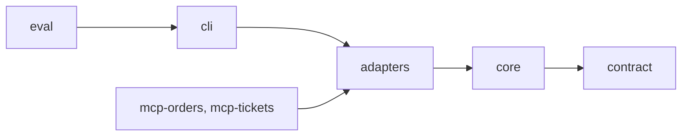
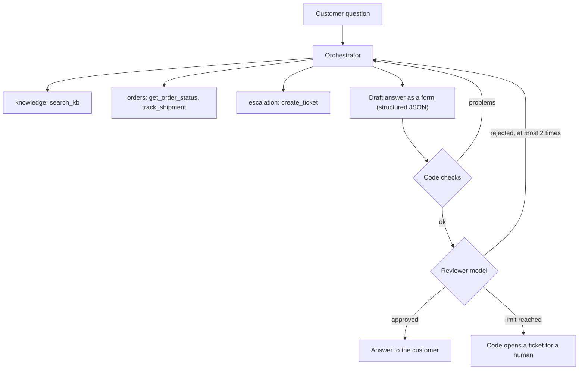

# DSupport

[English](README.md) | [Português](README.pt-BR.md)

A multi-agent customer support assistant, built by hand in Kotlin Multiplatform, with no agent framework: an orchestrator delegates to specialists, answers only from sources, and hands the case to a human when it cannot answer safely. It is measured by an evaluation that runs on every change.

- **Answers from sources.** A help-center search (RAG) backs policy answers; order data comes from tools. Nothing is invented: every ticket and source in an answer is checked against what the tools returned.
- **Safe by construction.** Guardrails written in code (not in prompts) enforce who may be asked what, hide national ids and card numbers, and allow one open ticket per customer, even when tool calls run in parallel.
- **Measured.** A golden dataset scores routing, groundedness, escalation, leaks, latency and tokens. See [the improvement log](docs/evals/improvement-log.md).

## A real run

```
$ REFERENCE_DATE=2026-10-15 ./gradlew :cli:run --args="My order 1042 has not arrived. My email is ana@example.com"

[orchestrator] calls orders {"task":"Check the status, tracking and delivery ..."}
[orders] calls get_order_status {"order_id":"1042","email":"ana@example.com"}
[orders] calls track_shipment   {"order_id":"1042","email":"ana@example.com"}     <- in parallel
[orders] get_order_status finished in 12 ms: {"ok":true,"status":"in_transit","late":true,"days_late":10,...}
[orchestrator] calls escalation {"task":"Delayed order. Order number: 1042 ..."}
[escalation] create_ticket finished in 17 ms: {"ok":true,"ticket_id":"TCK-1001"}
review round 1: rejected (...)    review round 2: approved

{ "answer": "Hi Ana, ... Your order 1042 is in transit with FastShip ... late by 10 days ... I've opened ticket TCK-1001 ...",
  "intent": "order", "confidence": 0.8, "escalated": true, "ticket_id": "TCK-1001" }
```

The full trace is in [docs/presentation/samples](docs/presentation/samples/first-real-run-order-1042.txt): 12 model calls, about 15k tokens in and 2k out, a quarter of a cent with `claude-haiku-5-5`.

## Architecture

Modules, each depending only on the ones to its right (an arrow means "depends on"):



- `contract`: types shared by every client (`SupportAnswer`, `AgentEvent`), multiplatform.
- `core`: the agent loop, orchestrator, guardrails, reviewer and every **port**. It knows no provider, no HTTP, no file.
- `adapters`: the Anthropic client, the RAG, the JSON repositories. The LLM is swappable: a new provider is an adapter that passes the contract test suite.
- `cli` and `eval`: assembly, terminal output and the evaluation.

What happens to a question:



Guardrails wrap every tool call and the final answer. The agent emits a stream of `AgentEvent`s that the terminal prints today and a UI will draw tomorrow.

## What each stage teaches

Each stage is a git tag (`git checkout etapa-4`) and has a guide in [docs/stages](docs/stages). The vocabulary used in talks is in [docs/presentation/glossary.md](docs/presentation/glossary.md).

| Tag | Concept | Plain language |
|---|---|---|
| `etapa-1` | **Agent loop** | the model decides, your code acts |
| `etapa-2` | **LLM client** (port + adapter) | swap the brain, keep the system |
| `etapa-3` | **Tools** | giving the assistant hands |
| `etapa-4` | **RAG** (Retrieval-Augmented Generation) | answering with a consultation |
| `etapa-5` | **MCP** (Model Context Protocol) | tools served by separate programs |
| `etapa-6` | **Multi-agent orchestration** | a team of specialists with a coordinator |
| `etapa-7` | **Guardrails** | rules the model can neither see nor skip |
| `etapa-8.1` | **Structured output** and validation | the answer as a form |
| `etapa-8.2` | **Producer–reviewer loop** | a second pair of eyes, with a limit |
| `etapa-9.1` | **Observability** | a trace tree and the cost of each agent |
| `etapa-9.2` | **Evals** | an exam with an answer key |

MCP servers (stage 5) are used by setting `MCP_SERVERS_FILE=config/mcp-servers.json` after `./gradlew installDist`; the terminal prints the trace tree and cost per agent (stage 9.1). Phase 2 adds a Ktor server and a small Compose Desktop app, see [docs/stages/11-12-interface.md](docs/stages/11-12-interface.md).

## Results

15 golden cases, 3 runs each, `claude-haiku-5-5`. Details and what each fix was in [docs/evals/improvement-log.md](docs/evals/improvement-log.md).

| Metric | Before | After |
|---|---|---|
| Routing accuracy | 100% | 100% |
| Groundedness | 100% | 100% |
| No identity leaks | 100% | 100% |
| Expected facts present | 93% | 100% |
| Expected sources cited | 86% | 100% |
| Escalation precision / recall | 80% / 100% | 100% / 100% |
| Handed to a human because no draft passed review | 9% | 0% |

The golden set is small (15 cases): it proves the method, not production readiness.

The teaching deck is [docs/presentation/index.html](docs/presentation/index.html) (open it in a browser, EN/PT toggle) and the article draft is [docs/article/article.md](docs/article/article.md).

## Run it

Requirements: JDK 21 (the Gradle JVM is pinned in `gradle/gradle-daemon-jvm.properties`, so the system `java` can differ).

```bash
./gradlew test
```

The tests (more than 380) run offline, with no key.

To talk to the real assistant, copy `.env.example` to `.env`, put your `ANTHROPIC_API_KEY` in it, and load it in the terminal (never commit it):

```bash
set -a; source .env; set +a
```

```bash
REFERENCE_DATE=2026-10-15 ./gradlew :cli:run --args="Where is my order 1042? I am ana@example.com"
```

The evaluation prints its estimated cost before starting (about 9 cents for the full 45 executions):

```bash
./gradlew :eval:run --args="--repeat=3"
```

`REFERENCE_DATE` fixes what "today" means, so "late" does not change with the calendar. `data/tickets.json` changes when you run the CLI: reset it to `[]` before committing.

### Server and app

Terminal 1 (the key stays on the server):

```bash
set -a; source .env; set +a
./gradlew :server:run
```

Terminal 2 (Compose Desktop, Portuguese by default, PT/EN selector, light and dark themes):

```bash
./gradlew :app:run
```

Try it without the app: `curl -N -X POST localhost:8080/chat -H 'Content-Type: application/json' -d '{"question":"Where is my order 1001? My email is ana@example.com"}'`.

### Tools over MCP

```bash
./gradlew installDist
MCP_SERVERS_FILE=config/mcp-servers.json ./gradlew :server:run
```

### Reset the tickets file

```bash
echo '[]' > data/tickets.json
```

### Settings

| Variable | Used by | Default |
|---|---|---|
| `ANTHROPIC_API_KEY` | server, CLI, eval | required |
| `ANTHROPIC_MODEL` | server, CLI, eval | `claude-haiku-5-5` |
| `DATA_DIR` | server, CLI, eval, MCP servers | `data` |
| `REFERENCE_DATE` | CLI, eval, `mcp-orders` | today |
| `MCP_SERVERS_FILE` | server, CLI | unset (local tools) |
| `PORT` | server | `8080` |
| `DSUPPORT_SERVER` | app | `http://localhost:8080` |

## Documentation

Project documents exist in English (`name.md`) and Portuguese (`name.pt-BR.md`): this README, the [checklist](CHECKLIST.md), the ADRs in `docs/adr`, the stage guides, the glossary and the improvement log. The design spec and the implementation plan under `docs/superpowers` are working documents, kept in Portuguese only.
