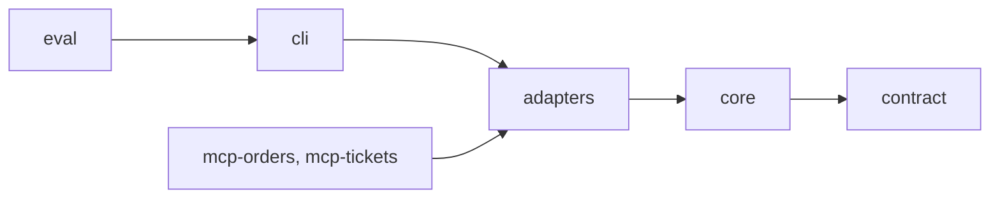
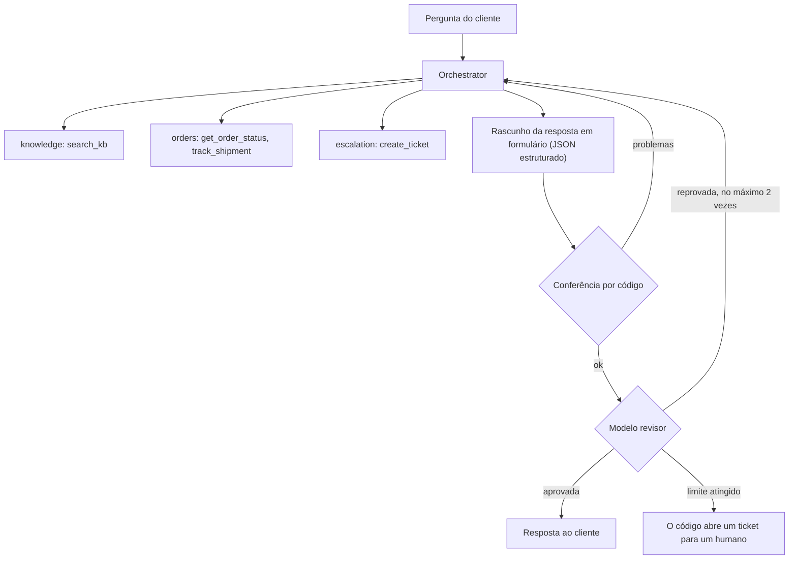

# DSupport

[English](README.md) | [Português](README.pt-BR.md)

Um assistente de suporte ao cliente multiagente, construído à mão em Kotlin Multiplatform, sem framework de agentes: um orquestrador delega a especialistas, responde só com base em fontes e passa o caso a um humano quando não consegue responder com segurança. Ele é medido por uma avaliação que roda a cada mudança.

- **Responde com fontes.** Uma busca na central de ajuda (RAG) sustenta as respostas de política; os dados de pedido vêm de ferramentas. Nada é inventado: todo ticket e toda fonte numa resposta é conferido contra o que as ferramentas devolveram.
- **Seguro por construção.** Guardrails escritas em código (não em prompts) impõem quem pode perguntar o quê, escondem documentos e números de cartão e permitem um ticket aberto por cliente, mesmo com chamadas de ferramenta em paralelo.
- **Medido.** Um golden dataset pontua roteamento, groundedness, escalação, vazamentos, latência e tokens. Veja [o diário de melhoria](docs/evals/improvement-log.pt-BR.md).

## Uma execução real

```
$ REFERENCE_DATE=2026-10-15 ./gradlew :cli:run --args="My order 1042 has not arrived. My email is ana@example.com"

[orchestrator] calls orders {"task":"Check the status, tracking and delivery ..."}
[orders] calls get_order_status {"order_id":"1042","email":"ana@example.com"}
[orders] calls track_shipment   {"order_id":"1042","email":"ana@example.com"}     <- em paralelo
[orders] get_order_status finished in 12 ms: {"ok":true,"status":"in_transit","late":true,"days_late":10,...}
[orchestrator] calls escalation {"task":"Delayed order. Order number: 1042 ..."}
[escalation] create_ticket finished in 17 ms: {"ok":true,"ticket_id":"TCK-1001"}
review round 1: rejected (...)    review round 2: approved

{ "answer": "Hi Ana, ... Your order 1042 is in transit with FastShip ... late by 10 days ... I've opened ticket TCK-1001 ...",
  "intent": "order", "confidence": 0.8, "escalated": true, "ticket_id": "TCK-1001" }
```

O rastro completo está em [docs/presentation/samples](docs/presentation/samples/first-real-run-order-1042.txt): 12 chamadas de modelo, cerca de 15 mil tokens de entrada e 2 mil de saída, um quarto de centavo com o `claude-haiku-5-5`.

## Arquitetura

Módulos, cada um dependendo só dos que estão à sua direita (a seta significa "depende de"):



- `contract`: tipos compartilhados por todo cliente (`SupportAnswer`, `AgentEvent`), multiplataforma.
- `core`: o loop do agente, o orquestrador, as guardrails, o revisor e todas as **portas**. Não conhece provedor, HTTP nem arquivo.
- `adapters`: o cliente da Anthropic, o RAG, os repositórios JSON. O LLM é trocável: um provedor novo é um adaptador que passa na suíte de contrato.
- `cli` e `eval`: montagem, saída no terminal e a avaliação.

O que acontece com uma pergunta:



As guardrails envolvem toda chamada de ferramenta e a resposta final. O agente emite um fluxo de `AgentEvent`s que o terminal imprime hoje e que uma interface vai desenhar amanhã.

## O que cada etapa ensina

Cada etapa é uma tag do git (`git checkout etapa-4`) e tem um guia em [docs/stages](docs/stages). O vocabulário usado nas apresentações está em [docs/presentation/glossary.pt-BR.md](docs/presentation/glossary.pt-BR.md).

| Tag | Conceito | Em linguagem simples |
|---|---|---|
| `etapa-1` | **Agent loop** | o modelo decide, o seu código age |
| `etapa-2` | **LLM client** (porta + adaptador) | troca o cérebro, mantém o sistema |
| `etapa-3` | **Tools** | dar mãos ao assistente |
| `etapa-4` | **RAG** (Retrieval-Augmented Generation) | responder com consulta |
| `etapa-5` | **MCP** (Model Context Protocol) | ferramentas servidas por programas separados |
| `etapa-6` | **Multi-agent orchestration** | uma equipe de especialistas com um coordenador |
| `etapa-7` | **Guardrails** | regras que o modelo não vê nem pula |
| `etapa-8.1` | **Structured output** (saída estruturada) e validação | a resposta em formulário |
| `etapa-8.2` | **Producer–reviewer loop** | uma segunda opinião, com limite |
| `etapa-9.1` | **Observability** | uma árvore de rastro e o custo de cada agente |
| `etapa-9.2` | **Evals** | uma prova com gabarito |

Os servidores MCP (etapa 5) são usados definindo `MCP_SERVERS_FILE=config/mcp-servers.json` depois de `./gradlew installDist`; o terminal imprime a árvore de rastro e o custo por agente (etapa 9.1). A fase 2 traz um servidor Ktor e um appzinho em Compose Desktop, veja [docs/stages/11-12-interface.pt-BR.md](docs/stages/11-12-interface.pt-BR.md).

## Resultados

15 casos de referência, 3 execuções cada, `claude-haiku-5-5`. Detalhes e o que foi cada correção em [docs/evals/improvement-log.pt-BR.md](docs/evals/improvement-log.pt-BR.md).

| Métrica | Antes | Depois |
|---|---|---|
| Acerto de roteamento | 100% | 100% |
| Groundedness | 100% | 100% |
| Sem vazamento de identidade | 100% | 100% |
| Fatos esperados presentes | 93% | 100% |
| Fontes esperadas citadas | 86% | 100% |
| Precisão / recall de escalação | 80% / 100% | 100% / 100% |
| Passou a um humano porque nenhuma versão passou na revisão | 9% | 0% |

O conjunto de referência é pequeno (15 casos): prova o método, não que está pronto para produção.

## Como rodar

Requisitos: JDK 21 (a JVM do Gradle é fixada em `gradle/gradle-daemon-jvm.properties`, então o `java` do sistema pode ser outro).

```bash
./gradlew test
```

Os testes (mais de 380) rodam offline, sem chave.

Para conversar com o assistente de verdade, copie o `.env.example` para `.env`, coloque a sua `ANTHROPIC_API_KEY` nele e carregue no terminal (nunca faça commit dele):

```bash
set -a; source .env; set +a
```

```bash
REFERENCE_DATE=2026-10-15 ./gradlew :cli:run --args="Where is my order 1042? I am ana@example.com"
```

A avaliação mostra o custo estimado antes de começar (cerca de 9 centavos de dólar para as 45 execuções completas):

```bash
./gradlew :eval:run --args="--repeat=3"
```

`REFERENCE_DATE` fixa o que "hoje" significa, para "atrasado" não mudar com o calendário. O `data/tickets.json` muda quando você roda o CLI: volte-o para `[]` antes de commitar.

## Documentação

Os documentos do projeto existem em inglês (`nome.md`) e em português (`nome.pt-BR.md`): este README, o [checklist](CHECKLIST.pt-BR.md), os ADRs em `docs/adr`, os guias de etapa, o glossário e o diário de melhoria. A spec de design e o plano de implementação em `docs/superpowers` são documentos de trabalho, mantidos só em português.
