[English](README.md) | [Português](README.pt-BR.md)

# Your "AI agent" is mostly if statements (and that is the point)

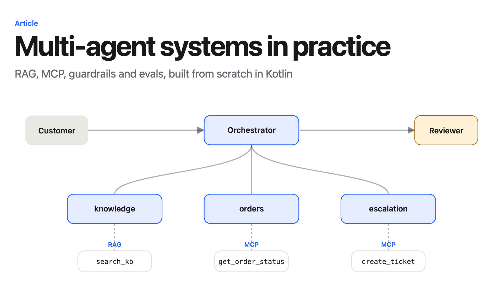

> **Title options for Medium (pick one)**
> 1. *Provocative:* "Your 'AI agent' is mostly if statements (and that is the point)"
> 2. *Career:* "I built a multi-agent AI assistant without a framework. Here is what it taught me."
> 3. *Best practices:* "RAG, MCP and multi-agent in practice: where the model belongs and where plain code must win"

> [!WARNING]
> **Opening provocation**
> The market is flooded with buzzwords: RAG, MCP, multi-agent architecture, guardrails. Every day a new framework promises "autonomous agents in two lines".
> What happens when a demo agent meets a real support desk? It invents policies, ignores business rules and leaks data.
> Enough *vibes-based engineering*.

So I built one from scratch in Kotlin, with no framework, and measured it. No jargon wall: first the ideas in plain words, then the code for the curious.

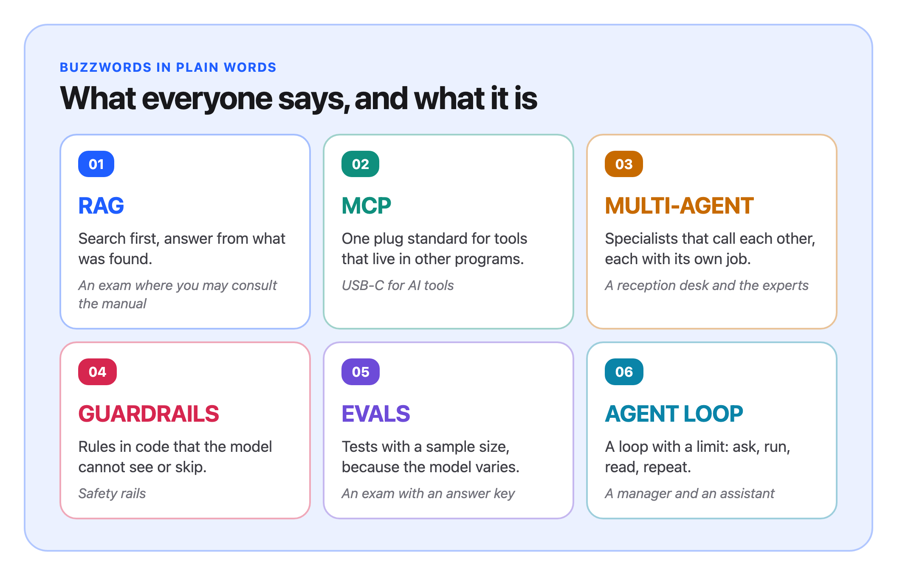

---

## 1️⃣ The big illusion of "everything is an LLM": deterministic vs non-deterministic

There is an illusion that the language model should decide 100% of a piece of software. But an LLM is a **probabilistic** engine. Asking it, by prompt, to never print a credit card in a log is Russian roulette.

```text
+-----------------------------------------------------------------------+
|                        HYBRID SYSTEM (DSupport)                        |
+------------------------------------+----------------------------------+
|  Model (non-deterministic)         |  Code (deterministic)            |
+------------------------------------+----------------------------------+
|  - understand natural language     |  - validate types and rules      |
|  - decide which tool to call       |  - hide sensitive data           |
|  - draft the reply                 |  - block what must not pass      |
|  - route between specialists       |  - tests that run offline        |
+------------------------------------+----------------------------------+
```

**Three ways to build it:**

**1 · Only deterministic (`if/else`, state machines).** It does not hallucinate, but it does not understand paraphrase and the rule list grows forever.
**2 · Only a model ("autonomous agent").** It promises everything and delivers unpredictable answers, endless loops and runaway cost.
**3 · Hybrid (DSupport).** The model understands and picks tools. The code validates, blocks and tests.

> [!WARNING]
> **Alert**
> Relying on the prompt alone fails in production. A prompt is a suggestion, not a guarantee. A prompt injection or a stochastic variation breaks the rule.

Be honest: a deterministic version is the first thing you should try. Here is what it looks like.

```kotlin
// A deterministic support router (illustration, not in the repo)
fun route(message: String): Intent = when {
    "refund" in message.lowercase()                       -> Intent.POLICY
    Regex("""order\s*#?\d+""").containsMatchIn(message)   -> Intent.ORDER
    else                                                  -> Intent.OTHER
}
```

It is fast, free, testable and 100% predictable. Now feed it what customers actually write:

```text
"my package never showed up"           -> OTHER   (wrong)
"where is the thing I bought Monday?"  -> OTHER   (wrong)
"quero meu dinheiro de volta"          -> OTHER   (wrong)
```

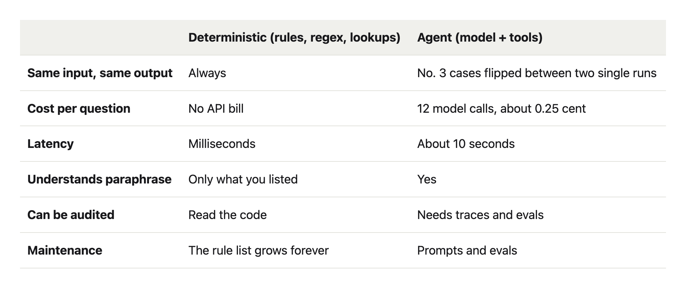

> [!WARNING]
> **Alert**
> The deterministic version fails on **language**, not on logic. The agent fails on **trust**. Pick the failure you can live with.

#### The decision, as five blocks

**1 · Closed input, known rules?** Use code. Do not pay for a model to read a status enum.
**2 · Open language, many phrasings?** Use a model to understand it.
**3 · Cannot be wrong (money, identity, permissions)?** The model **proposes**, code **decides**.
**4 · Must be auditable?** Code, or a model whose output code validates.
**5 · Tiny cost or latency budget?** Code.

#### Where the model is, and where code is

Five roles use a model: the orchestrator and the three specialists, plus the reviewer. Fourteen pieces are plain code: `IdentityGate`, `Redaction`, `RedactResults`, `MentionTicket`, `TicketDedup`, `GuardPolicy`, `SupportAnswerValidator`, the review limit and escalation, `MarkdownChunker`, the TF-IDF search, the four tools, the MCP client and servers, `TraceReport` and the eval scorer.

> [!TIP]
> **Takeaway**
> Use the model at the **edges** (understanding language, writing the reply). Keep the **middle** deterministic.

---

---

## 2️⃣ The project and the architecture: clean separation of responsibilities

A support assistant. A customer writes:

> "My order 1042 has not arrived. My email is ana@example.com"

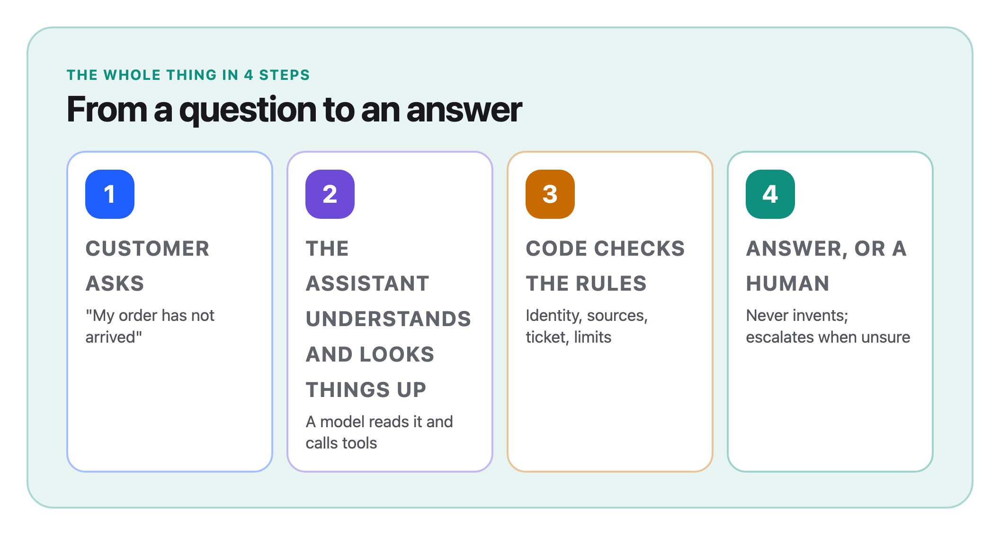

It must answer **only from sources**, **never invent** a ticket number, **hand the case to a human** when unsure, and be **measured**, not admired.

Repository: github.com/diegoferreiracaetano/dsupport-kt

```text
dsupport-kt/
├── contract/      shared vocabulary: events, answer          (Kotlin Multiplatform)
├── core/          ports, agent loop, guards, review, use case (Kotlin Multiplatform)
├── adapters/      Anthropic client, RAG, JSON files, MCP client
├── cli/           terminal entry point
├── eval/          golden dataset, scoring, reports
├── mcp-orders/    MCP server: order tools
├── mcp-tickets/   MCP server: ticket tools
├── server/        Ktor API (Server-Sent Events)
├── app/           Compose app (desktop and iOS)
├── config/        agents.json, mcp-servers.json
└── data/          orders, golden dataset, help-center articles
```

> [!IMPORTANT]
> **Rule of thumb**
> Dependencies point **inward**. The core defines ports (interfaces). Adapters at the edge implement them. The core never imports a provider.

---

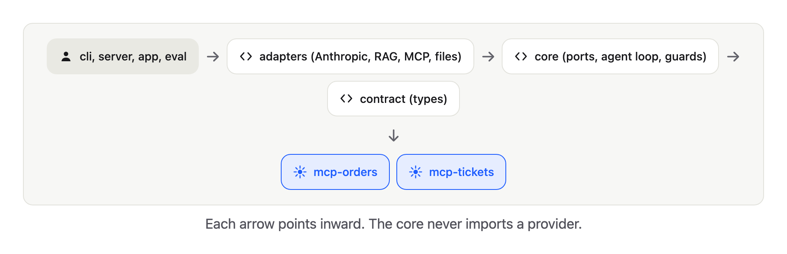

**How the modules are separated**

**1 · `contract`**: the shared types (`SupportAnswer`, `AgentEvent`). No dependencies, ready for Kotlin Multiplatform.
**2 · `core`**: the heart. Agent loop, orchestration, guardrails and the **ports** (interfaces). It does not know what HTTP, Anthropic or JSON is.
**3 · `adapters`**: implement the ports. Anthropic client, RAG, files, MCP client. Swapping Claude for another model is writing a new adapter, without touching `core`.
**4 · `mcp-orders` and `mcp-tickets`**: independent servers that speak MCP.
**5 · `cli`, `server`, `app`**: entry points (terminal, Ktor API with SSE, Compose app).
**6 · `eval`**: the evaluation suite with a golden dataset.

---

## 3️⃣ The concepts in practice (from theory to code)

### 01 · Agent loop: the model decides, your code acts

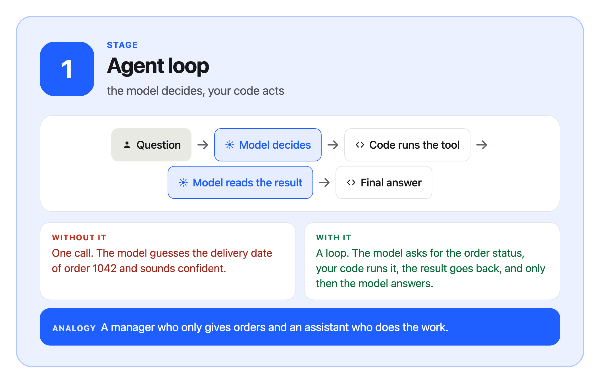

A model only produces text. The loop lets it ask for help, read the result and try again.

```kotlin
private suspend fun loop(): String {
    repeat(maxTurns) {                                     // always bounded
        val reply = llm.next(LlmRequest(system, history.toList(), specs))
        when (reply) {
            is LlmReply.Text -> return finalAnswer(reply.text)       // done
            is LlmReply.ToolCalls -> {
                // the model only ASKS. Several calls in one turn run in parallel
                val results = coroutineScope {
                    reply.calls.map { call -> async { execute(call.tool, call.args) } }.awaitAll()
                }
                // results go back into the history, in the order they were requested
                reply.calls.zip(results).forEach { (call, r) ->
                    history += Message.ToolResult(call.id, call.tool, r.content, r.isError)
                }
            }
        }
    }
    return "Turn limit of $maxTurns reached. Escalating to a human agent."
}
```

> [!WARNING]
> **Alert**
> No limit means a confused model can call tools forever and burn your budget.

### 02 · LLM client: one port, one adapter per provider

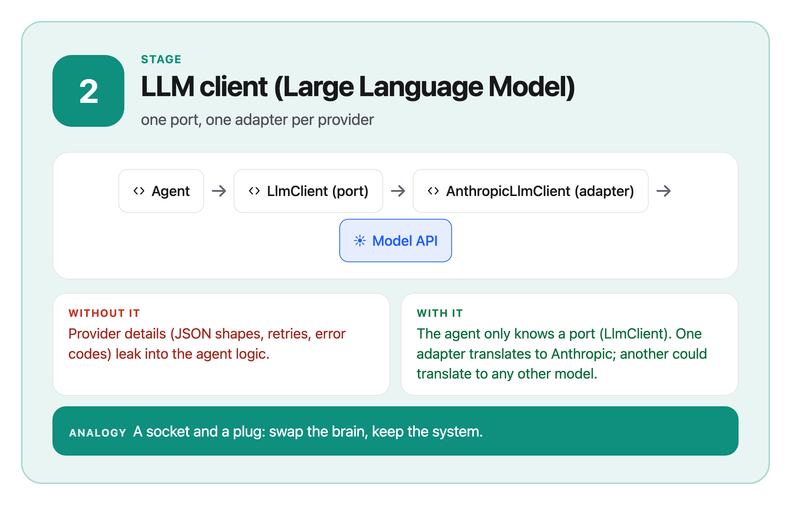

```kotlin
// Port, in the core. No provider import here.
interface LlmClient {
    suspend fun next(request: LlmRequest): LlmReply          // text or tool calls
    suspend fun structured(request: LlmRequest, schema: OutputSchema): StructuredReply
}
```

`AnthropicLlmClient` is the adapter. It retries on 429 and 5xx, and fails fast on 400 and 401 because retrying does not fix them.

### 03 · Tools: functions the model can ask for

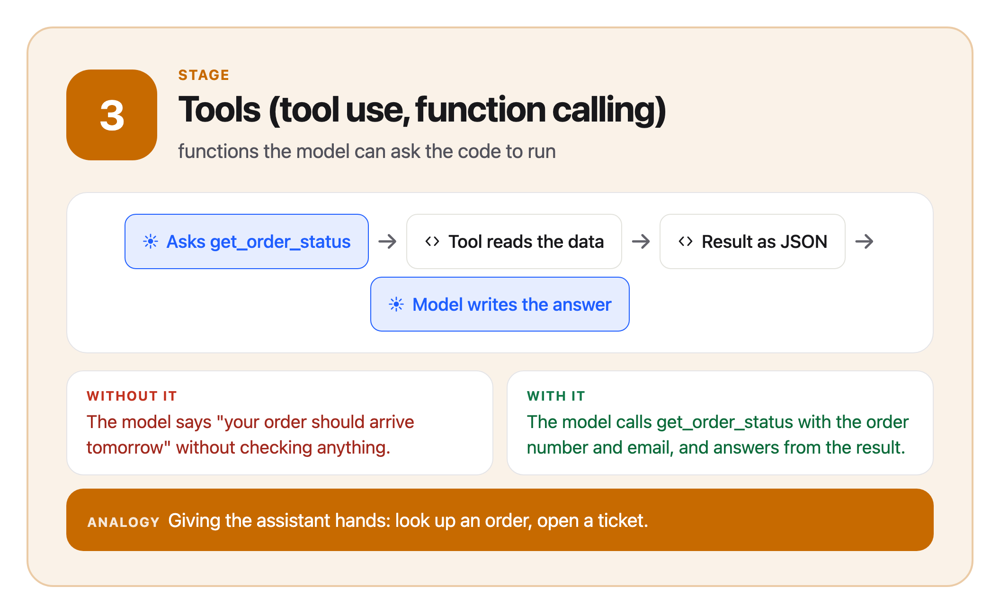

```kotlin
class GetOrderStatusTool(private val orders: OrderGateway) : Tool {
    override val spec = ToolSpec(
        name = "get_order_status",
        description = "Looks up the status and delay of an order. Requires order_id and email.",
        inputSchema = stringSchema("order_id", "email"),
    )

    override suspend fun run(args: JsonObject): ToolResult {
        val orderId = args.stringArg("order_id") ?: return fail("missing_argument:order_id")
        val email = args.stringArg("email") ?: return fail("missing_argument:email")
        // A tool never throws: the failure comes back as a result the model can read.
        val order = orders.findOwned(orderId, email) ?: return fail("order_not_found_or_email_mismatch")
        return ok("status" to JsonPrimitive(order.status.wire), "eta" to JsonPrimitive(order.eta.toString()))
    }
}
```

> [!TIP]
> **Tip**
> The description is part of the prompt. A vague description makes the model pick the wrong tool.

### 04 · RAG: answer with a consultation

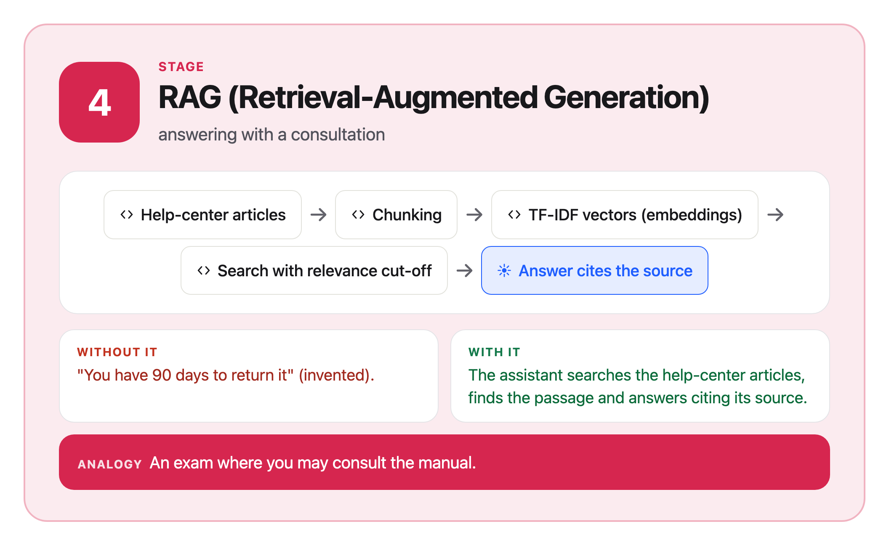

**1** split articles into passages (chunking) · **2** turn passages into vectors (TF-IDF embeddings) · **3** return the closest ones · **4** drop anything below a relevance cut-off.

```kotlin
// SearchKbTool: the cut-off is what stops "answering from an unrelated passage"
val relevant = kb.search(query).filter { it.score >= minScore }    // minScore = 0.25
if (relevant.isEmpty()) return fail("nothing_relevant_found")        // say "nothing found"
```

> [!WARNING]
> **Alert**
> Without a cut-off, search always returns *something*, and the model happily answers from it.

### 05 · MCP: tools served by separate programs

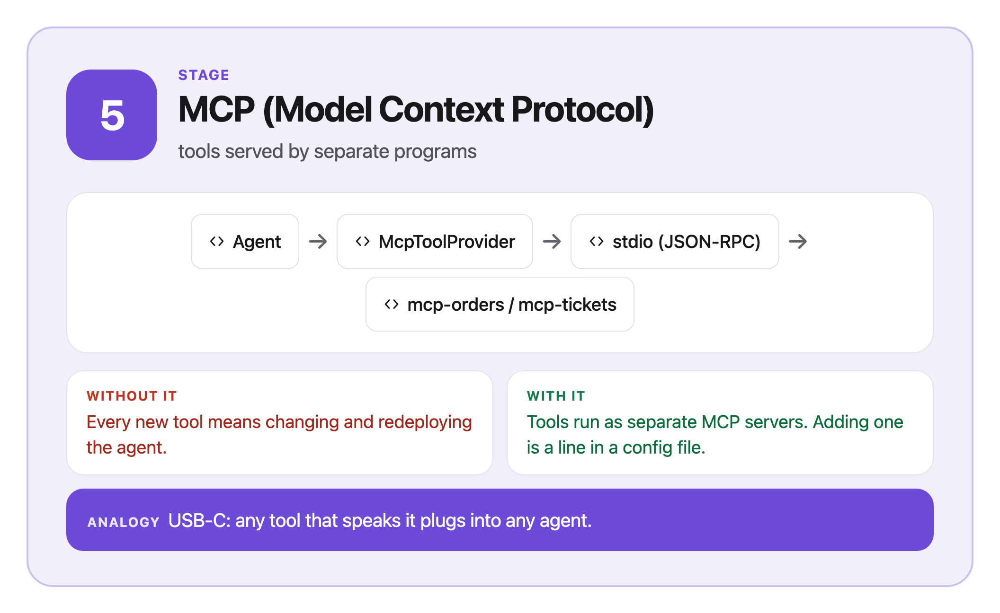

```json
{
  "servers": [
    { "name": "orders",  "command": ["mcp-orders/build/install/mcp-orders/bin/mcp-orders"],   "env": { "DATA_DIR": "data" } },
    { "name": "tickets", "command": ["mcp-tickets/build/install/mcp-tickets/bin/mcp-tickets"], "env": { "DATA_DIR": "data" } }
  ]
}
```

```kotlin
// A remote tool can time out, die or throw. The agent must never hang or crash.
override suspend fun run(args: JsonObject): ToolResult = try {
    withTimeout(timeoutMs) { connection.callTool(spec.name, args) }
} catch (e: Exception) {
    ToolResult("error: ${e.message}", isError = true)
}
```

Adding a server is one line of configuration. The agent code does not change.

> [!WARNING]
> **Alert**
> On a stdio MCP server, `stdout` **is** the protocol. One stray `println` corrupts the conversation.

### 06 · Multi-agent orchestration

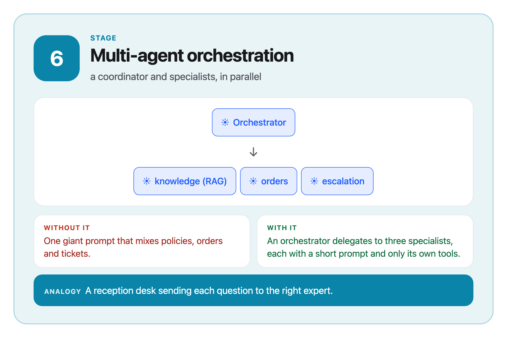

One agent with every tool gets confused. An orchestrator delegates, each specialist sees only its own tools.

```json
{
  "agents": {
    "knowledge":  { "tools": ["search_kb"] },
    "orders":     { "tools": ["get_order_status", "track_shipment"] },
    "escalation": { "tools": ["create_ticket"] }
  }
}
```

A specialist is exposed to the orchestrator **as a tool**, and a fresh agent is created per call, so histories never mix.

### 07 · Guardrails: rules the model cannot skip

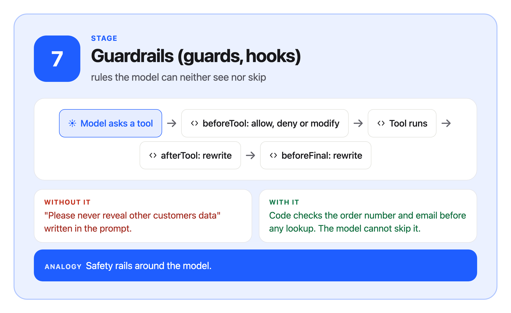

```kotlin
class IdentityGate : Hook {
    override val covers = setOf("get_order_status", "track_shipment")

    override suspend fun beforeTool(agent: String, tool: ToolSpec, args: JsonObject): Decision = when {
        // No valid order number: the model never reaches the tool.
        args.stringArg("order_id")?.let { digits.matches(it) } != true ->
            Decision.Deny("order_id is missing or invalid. Ask the customer for the order number.")
        args.stringArg("email")?.let { Patterns.email.matches(it) } != true ->
            Decision.Deny("email is missing or invalid. Ask the customer for the email used in the purchase.")
        else -> Decision.Allow
    }
}
```

Another one, for a real bug class: two parallel `create_ticket` calls.

```kotlin
// One open ticket per customer. A creation in flight RESERVES the customer,
// so two simultaneous calls cannot both pass.
override suspend fun beforeTool(agent: String, tool: ToolSpec, args: JsonObject): Decision {
    val email = customerOf(tool, args) ?: return Decision.Allow
    return lock.withLock {
        if (email in inFlight) return@withLock Decision.Deny("A ticket for this customer is already being created.")
        tickets.findOpenByEmail(email)?.let { return@withLock Decision.Deny("Ticket ${it.ticketId} is already open.") }
        inFlight += email
        Decision.Allow
    }
}
```

> [!WARNING]
> **Alert**
> "Please never create duplicate tickets" in the prompt is a wish. The `Mutex` is a guarantee.

### 08 · Structured output and validation

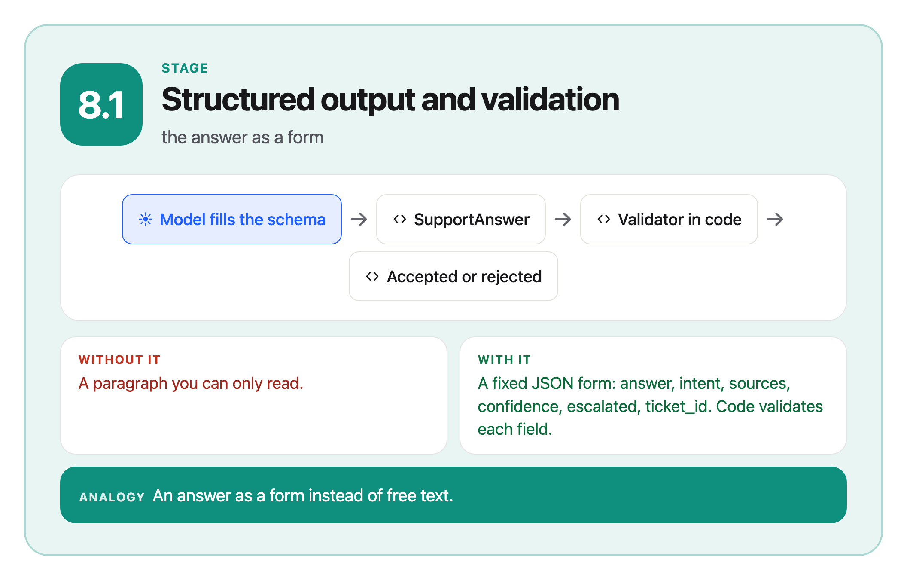

The final answer is a JSON form. Then plain code checks what a schema cannot.

```kotlin
fun problems(answer: SupportAnswer, evidence: List<String>): List<String> = buildList {
    val results = evidence.joinToString("\n")
    if (answer.intent !in INTENTS) add("invalid intent: ${answer.intent}")
    if (answer.confidence !in 0.0..1.0) add("confidence out of range 0..1")
    answer.ticketId?.let { ticket ->
        // an invented ticket id is rejected: it must appear in what the tools returned
        if (ticket !in results) add("ticket $ticket does not appear in the tool results (invented?)")
    }
    answer.sources.filter { !results.contains(it, ignoreCase = true) }
        .forEach { add("source \"$it\" does not appear in the tool results") }
}
```

### 09 · Producer and reviewer, with a limit

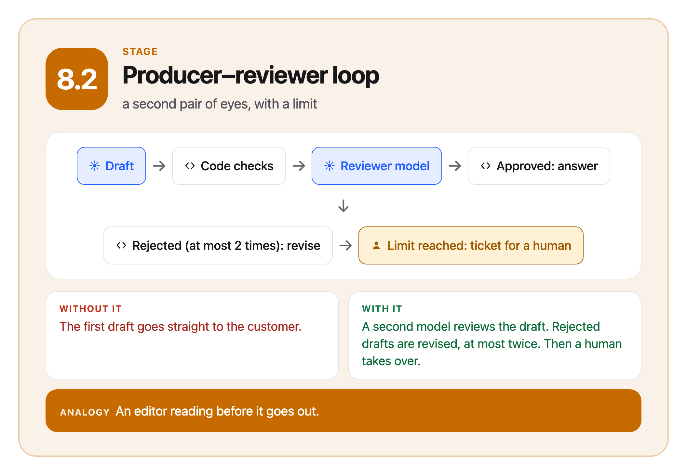

```kotlin
suspend fun answer(question: String): SupportAnswer {
    producer.run(question)
    for (round in 0..maxRevisions) {                                 // at most 2 revisions
        val draft = decode(producer.finish(SupportAnswerSchema.output))
        val problems = validator.problems(draft, producer.evidence)  // cheap, exact: code first
            .ifEmpty { review(question, draft) }                     // then a model judges the claims
        if (problems.isEmpty()) return draft
        producer.followUp("A reviewer rejected your answer. Fix these points:\n" + problems.joinToString("\n"))
    }
    return escalate(question)                                        // CODE opens the ticket, not the model
}
```

> [!TIP]
> **Takeaway**
> The reviewer is a model too. That is why deterministic checks run **first**.

### 10 · Observability: a flight recorder

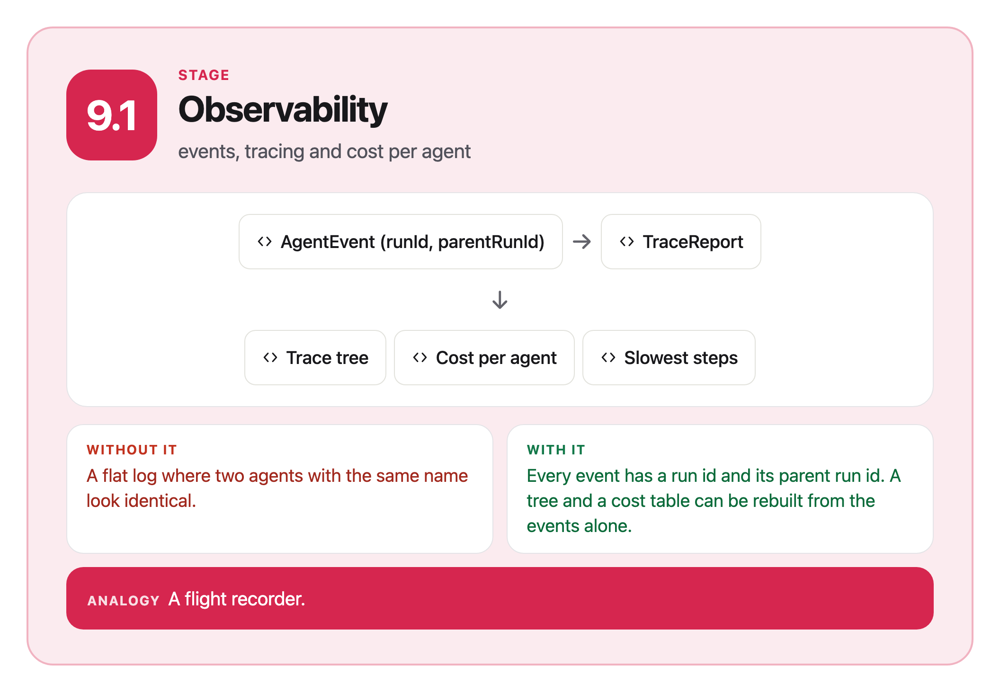

Every event carries a `runId` and a `parentRunId`, so a tree can be rebuilt:

```text
[orchestrator] r1
  model call: 900 in / 80 out tokens, 700 ms
  tool orders: 1300 ms
    [orders] r2
      model call: 400 in / 40 out tokens, 500 ms
```

### 11 · Evals: an exam with an answer key

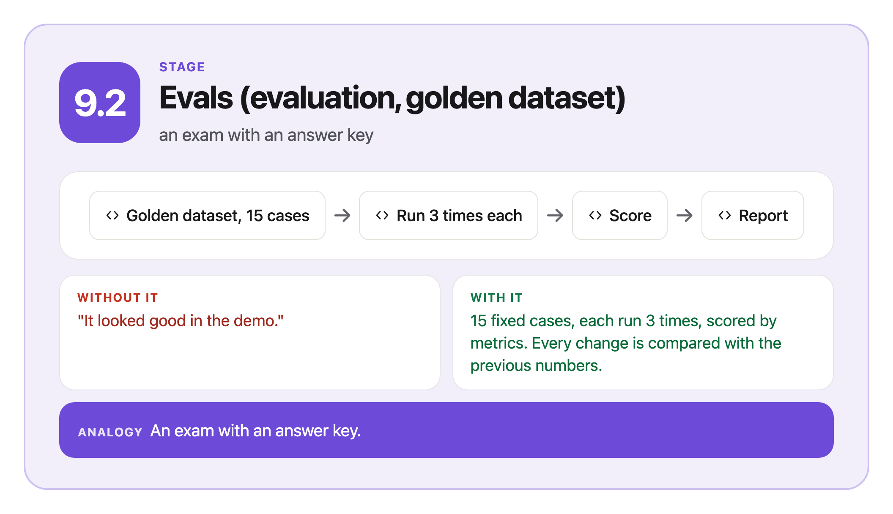

15 golden cases, each run 3 times, because the same code gave different results.

The evals found what code review never would: two rules that contradicted each other, a reviewer that invented objections, and a routing error that repeated every time. About 30 cents, one afternoon.

### 12 · Server and app

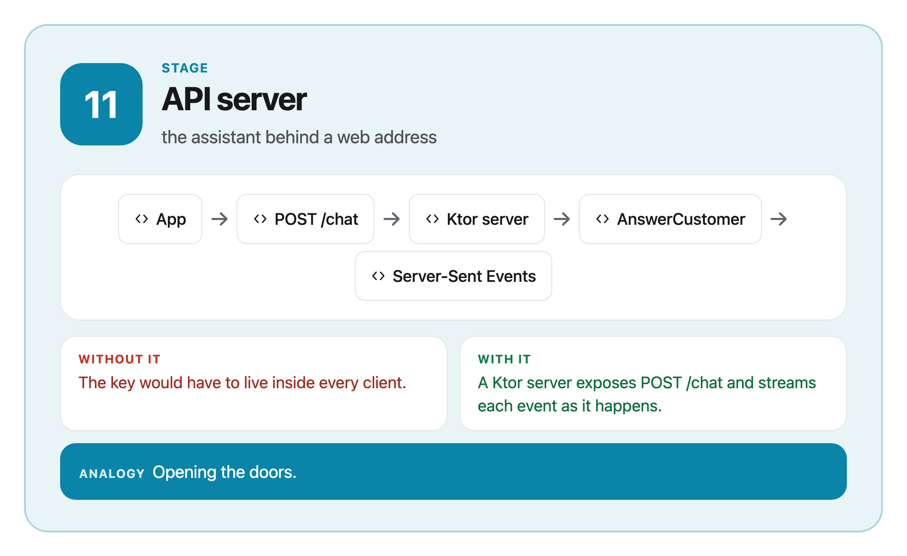

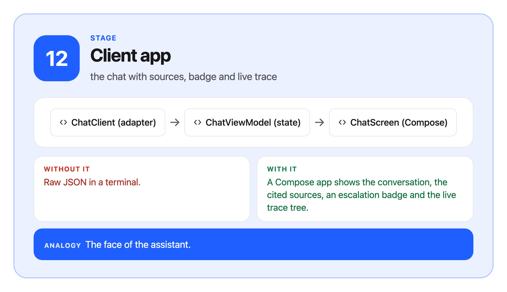

```kotlin
// POST /chat streams one Server-Sent Events frame per AgentEvent.
post("/chat") {
    val question = receiveQuestion() ?: return@post call.respondText("bad request", status = BadRequest)
    call.respondTextWriter(ContentType.Text.EventStream) {
        answerCustomer(question).collect { event ->
            write(ServerSentEvents.frame(event))
            flush()                      // flush is what makes the live trace possible
        }
    }
}
```

The API key lives only on the server. The Compose app draws the conversation, the sources, an escalation badge and the live trace.

---

---

## 4️⃣ Anatomy of a real run

The customer writes: `"My order 1042 has not arrived. My email is ana@example.com"`.

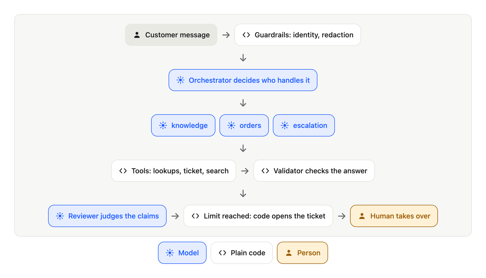

This is the real terminal trace (shortened):

```text
[orchestrator] calls orders {"task":"Check the status, tracking and delivery progress..."}
[orders] calls get_order_status {"order_id":"1042","email":"ana@example.com"}
[orders] calls track_shipment   {"order_id":"1042","email":"ana@example.com"}   <- in parallel
[orders] get_order_status finished in 12 ms: {"ok":true,"status":"in_transit","late":true,"days_late":10}
[orchestrator] calls escalation {"task":"Delayed order. Order number: 1042 ..."}
[escalation] create_ticket finished in 17 ms: {"ok":true,"ticket_id":"TCK-1001"}
review round 1: rejected (4 problems)
review round 2: approved
```

> [!TIP]
> **Efficiency and cost**
> 12 model calls, about 15 thousand input tokens and 2 thousand output tokens. Cost: **US$ 0.0025** (a quarter of a cent) with `claude-haiku-5-5`.

---

## 5️⃣ Evals: how to prove the agent works

If you do not measure the agent, you only have opinions. `eval` runs a golden dataset of 15 cases, 3 times each, on every change.

| Metric | Before | After | What it means in practice |
|---|---|---|---|
| Routing accuracy | 100% | 100% | The orchestrator sends the question to the right specialist |
| Groundedness | 100% | 100% | No answer invents facts outside the sources |
| No leaks | 100% | 100% | Customer data does not show up where it should not |
| Expected facts | 93% | 100% | The vital information was delivered |
| Cited sources | 86% | 100% | You can see where the answer came from |
| Escalation precision | 80% | 100% | Hands over to a human at the right time |
| Fallback after failed review | 9% | 0% | Answers refined without hitting the limit |

---

## Tests and containerization

One test class per production class. Doubles at the ports. **Zero API calls.**

```kotlin
@Test
fun `given a malformed email when checking an order tool then should deny`() = runTest {
    val decision = gate.beforeTool("orders", spec("get_order_status"),
        argsOf("order_id" to "1042", "email" to "not-an-email"))

    assertIs<Decision.Deny>(decision)
}
```

A multi-stage `Dockerfile` (build with the JDK, run with the JRE):

```dockerfile
# Stage 1: build the distribution with the full JDK
FROM eclipse-temurin:21-jdk AS build
WORKDIR /src
COPY . .
RUN ./gradlew :server:installDist --no-daemon

# Stage 2: run it on a small JRE image
FROM eclipse-temurin:21-jre
WORKDIR /app
COPY --from=build /src/server/build/install/server/ ./
COPY config ./config
COPY data ./data
ENV DATA_DIR=data
EXPOSE 8080
CMD ["bin/server"]
```

---
---

## The price of "multi"

> [!WARNING]
> **Alert**
> One delayed-order question cost **12 model calls**, about 15,000 input tokens and 10 seconds. Multi-agent is not free.

Use one agent with tools when the task is small. Split into specialists only when prompts and toolsets grow and the roles are clearly different.

## 🏁 Provocative conclusion

Software engineering did not change just because we now use AI. Agents without **strong typing**, **clean architecture**, **guardrails in code** and **automated evaluation** are unpredictable toys.

The innovation is not the framework of the week. It is knowing **where to use the model's non-determinism** and **where to use the determinism of code**.

---

### Conclusion

The model decides. Your code acts, validates and escalates. Rules live in code. Quality is measured. Providers are replaceable.

**Your turn**

**1** · Which rule in your own project could be code instead of a prompt? Tell me in the comments.
**2** · Disagree that most of an agent should be deterministic? I want to hear the counter-example.
**3** · Share this with someone about to build "an AI agent". A star on the repo helps: github.com/diegoferreiracaetano/dsupport-kt