[English](README.md) | [Português](README.pt-BR.md)

# Seu "agente de IA" é quase todo if (e é isso que importa)

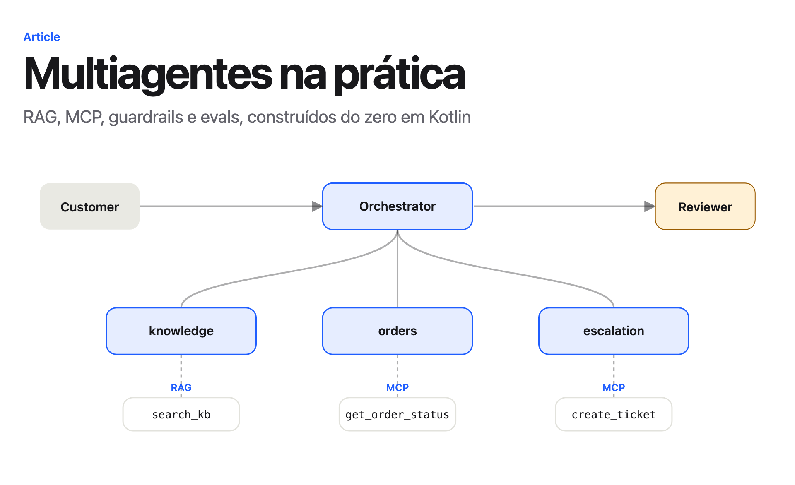

> **Opções de título para o Medium (escolha uma)**
> 1. *Provocativo:* "Seu 'agente de IA' é quase todo if (e é isso que importa)"
> 2. *Carreira:* "Construí um assistente de IA multiagente sem framework. Eis o que aprendi."
> 3. *Boas práticas:* "RAG, MCP e multiagente na prática: onde o modelo entra e onde o código comum tem que vencer"

> [!WARNING]
> **Provocação inicial**
> O mercado foi inundado de *buzzwords*: RAG, MCP, arquitetura multiagente, guardrails. Todo dia surge um framework prometendo "agentes autônomos em duas linhas".
> Mas o que acontece quando um agente de demo encontra um suporte ao cliente de verdade? Ele inventa políticas, ignora regras de negócio e vaza dados.
> Chega de *vibes-based engineering*.

Então construí um do zero em Kotlin, sem framework, e medi. Sem paredão de jargão: primeiro as ideias em palavras simples, depois o código para os curiosos.

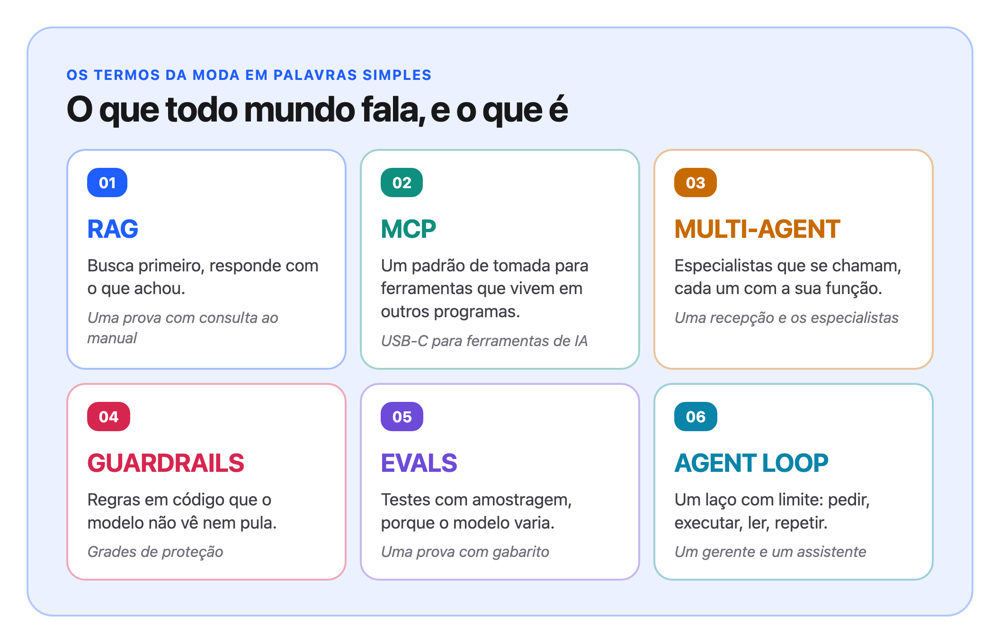

---

## 1️⃣ A grande ilusão do "tudo é LLM": determinístico vs não-determinístico

Existe a ilusão de que o modelo de linguagem deve decidir 100% do software. Mas um LLM é um motor **probabilístico**. Pedir a ele, por prompt, que nunca mostre um cartão de crédito no log é roleta-russa.

```text
+-----------------------------------------------------------------------+
|                       SISTEMA HÍBRIDO (DSupport)                       |
+------------------------------------+----------------------------------+
|  Modelo (não-determinístico)       |  Código (determinístico)         |
+------------------------------------+----------------------------------+
|  - entender linguagem natural      |  - validar tipos e regras        |
|  - decidir qual ferramenta chamar  |  - ocultar dados sensíveis       |
|  - rascunhar a resposta            |  - barrar o que não pode passar  |
|  - rotear entre especialistas      |  - testes que rodam offline      |
+------------------------------------+----------------------------------+
```

**Três jeitos de construir isso:**

**1 · Só determinístico (`if/else`, máquinas de estado).** Não alucina, mas não entende paráfrase e a lista de regras cresce para sempre.
**2 · Só modelo ("agente autônomo").** Promete tudo, entrega respostas imprevisíveis, laços infinitos e custo fora de controle.
**3 · Híbrido (o DSupport).** O modelo entende e escolhe ferramentas. O código valida, barra e testa.

> [!WARNING]
> **Alerta**
> Depender só do prompt falha em produção. Prompt é sugestão, não garantia. Uma injeção de prompt ou uma variação estocástica quebra a regra.

Sendo honesto: uma versão determinística é a primeira coisa que você deve tentar. Veja como ela fica.

```kotlin
// Um roteador de suporte determinístico (ilustração, não está no repositório)
fun route(message: String): Intent = when {
    "refund" in message.lowercase()                       -> Intent.POLICY
    Regex("""order\s*#?\d+""").containsMatchIn(message)   -> Intent.ORDER
    else                                                  -> Intent.OTHER
}
```

É rápido, grátis, testável e 100% previsível. Agora dê a ele o que os clientes realmente escrevem:

```text
"my package never showed up"           -> OTHER   (errado)
"where is the thing I bought Monday?"  -> OTHER   (errado)
"quero meu dinheiro de volta"          -> OTHER   (errado)
```

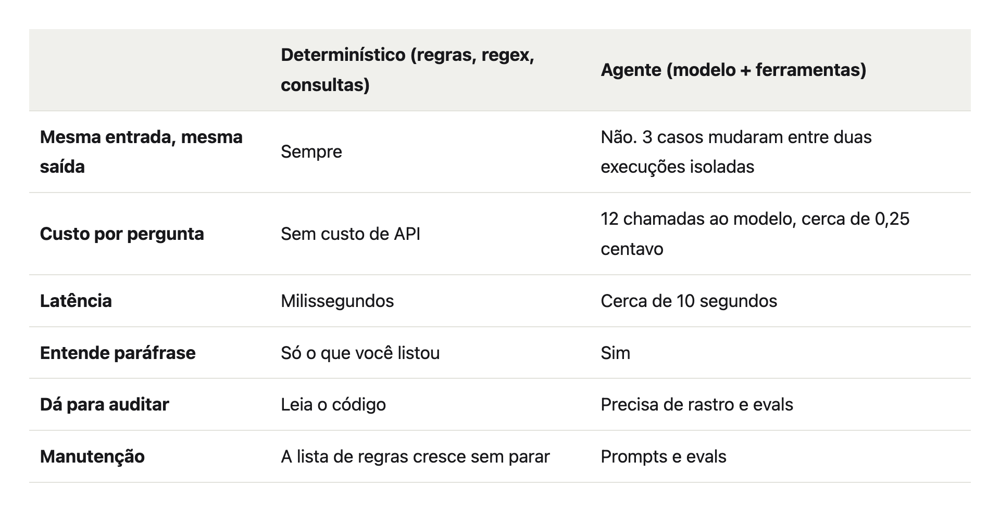

> [!WARNING]
> **Alerta**
> A versão determinística falha na **linguagem**, não na lógica. O agente falha na **confiança**. Escolha a falha com a qual você consegue viver.

#### A decisão, em cinco blocos

**1 · Entrada fechada, regras conhecidas?** Use código. Não pague um modelo para ler um enum de status.
**2 · Linguagem aberta, muitas formas de dizer?** Use um modelo para entender.
**3 · Não pode errar (dinheiro, identidade, permissões)?** O modelo **propõe**, o código **decide**.
**4 · Precisa ser auditável?** Código, ou um modelo cuja saída o código valida.
**5 · Orçamento mínimo de custo ou latência?** Código.

#### Onde está o modelo e onde está o código

Cinco papéis usam um modelo: o orquestrador e os três especialistas, mais o revisor. Catorze peças são código comum: `IdentityGate`, `Redaction`, `RedactResults`, `MentionTicket`, `TicketDedup`, `GuardPolicy`, `SupportAnswerValidator`, o limite da revisão e o escalonamento, `MarkdownChunker`, a busca TF-IDF, as quatro ferramentas, o cliente e os servidores MCP, `TraceReport` e o pontuador dos evals.

> [!TIP]
> **Conclusão**
> Use o modelo nas **bordas** (entender a linguagem, escrever a resposta). Mantenha o **meio** determinístico.

---

---

## 2️⃣ O projeto e a arquitetura: separação limpa de responsabilidades

Um assistente de suporte. Um cliente escreve:

> "My order 1042 has not arrived. My email is ana@example.com"

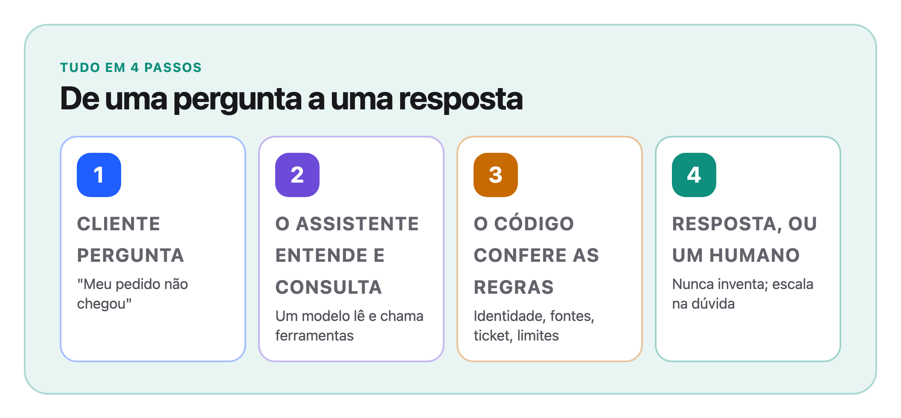

Ele precisa responder **só com fontes**, **nunca inventar** um número de ticket, **passar o caso a um humano** na dúvida e ser **medido**, não admirado.

Repositório: github.com/diegoferreiracaetano/dsupport-kt

```text
dsupport-kt/
├── contract/      vocabulário compartilhado: eventos, resposta   (Kotlin Multiplatform)
├── core/          portas, agent loop, guards, revisão, caso de uso (Kotlin Multiplatform)
├── adapters/      cliente Anthropic, RAG, arquivos JSON, cliente MCP
├── cli/           entrada pelo terminal
├── eval/          golden dataset, pontuação, relatórios
├── mcp-orders/    servidor MCP: ferramentas de pedidos
├── mcp-tickets/   servidor MCP: ferramentas de tickets
├── server/        API Ktor (Server-Sent Events)
├── app/           app Compose (desktop e iOS)
├── config/        agents.json, mcp-servers.json
└── data/          pedidos, golden dataset, artigos da central de ajuda
```

> [!IMPORTANT]
> **Regra de bolso**
> As dependências apontam **para dentro**. O core define portas (interfaces). Adapters na borda as implementam. O core nunca importa um provedor.

---

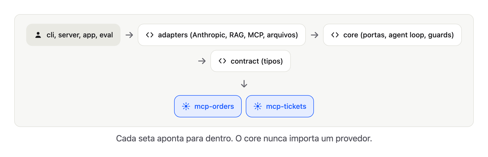

**Como os módulos são separados**

**1 · `contract`**: os tipos compartilhados (`SupportAnswer`, `AgentEvent`). Sem dependências, pronto para Kotlin Multiplatform.
**2 · `core`**: o coração. Agent loop, orquestração, guardrails e as **portas** (interfaces). Ele não sabe o que é HTTP, Anthropic ou JSON.
**3 · `adapters`**: implementam as portas. Cliente Anthropic, RAG, arquivos, cliente MCP. Trocar o Claude por outro modelo é escrever um adapter novo, sem tocar no `core`.
**4 · `mcp-orders` e `mcp-tickets`**: servidores independentes que falam MCP.
**5 · `cli`, `server`, `app`**: pontos de entrada (terminal, API Ktor com SSE, app Compose).
**6 · `eval`**: a suíte de avaliação com golden dataset.

---

## 3️⃣ Os conceitos na prática (da teoria ao código)

### 01 · Agent loop: o modelo decide, o seu código age

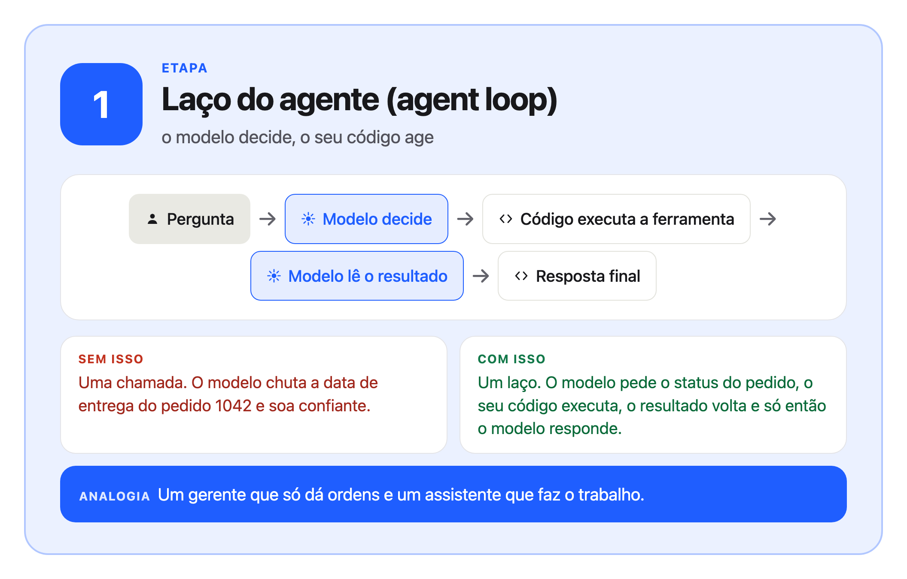

Um modelo só produz texto. O laço deixa ele pedir ajuda, ler o resultado e tentar de novo.

```kotlin
private suspend fun loop(): String {
    repeat(maxTurns) {                                     // sempre limitado
        val reply = llm.next(LlmRequest(system, history.toList(), specs))
        when (reply) {
            is LlmReply.Text -> return finalAnswer(reply.text)       // pronto
            is LlmReply.ToolCalls -> {
                // o modelo só PEDE. Várias chamadas no mesmo turno rodam em paralelo
                val results = coroutineScope {
                    reply.calls.map { call -> async { execute(call.tool, call.args) } }.awaitAll()
                }
                // os resultados voltam ao histórico, na ordem em que foram pedidos
                reply.calls.zip(results).forEach { (call, r) ->
                    history += Message.ToolResult(call.id, call.tool, r.content, r.isError)
                }
            }
        }
    }
    return "Turn limit of $maxTurns reached. Escalating to a human agent."
}
```

> [!WARNING]
> **Alerta**
> Sem limite, um modelo confuso pode chamar ferramentas para sempre e queimar o seu orçamento.

### 02 · Cliente de LLM: uma porta, um adapter por provedor

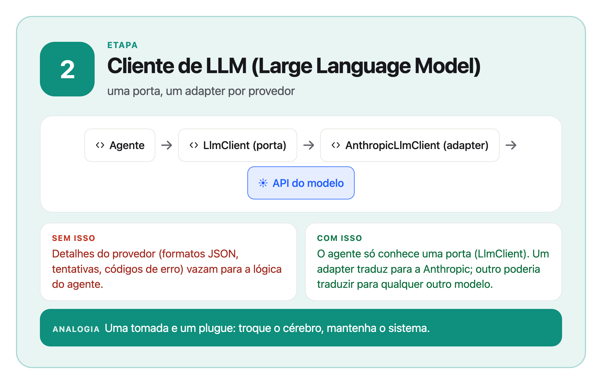

```kotlin
// Porta, no core. Nenhum import de provedor aqui.
interface LlmClient {
    suspend fun next(request: LlmRequest): LlmReply          // texto ou chamadas de ferramenta
    suspend fun structured(request: LlmRequest, schema: OutputSchema): StructuredReply
}
```

O `AnthropicLlmClient` é o adapter. Ele repete em 429 e 5xx e falha na hora em 400 e 401, porque repetir não resolve.

### 03 · Ferramentas: funções que o modelo pode pedir

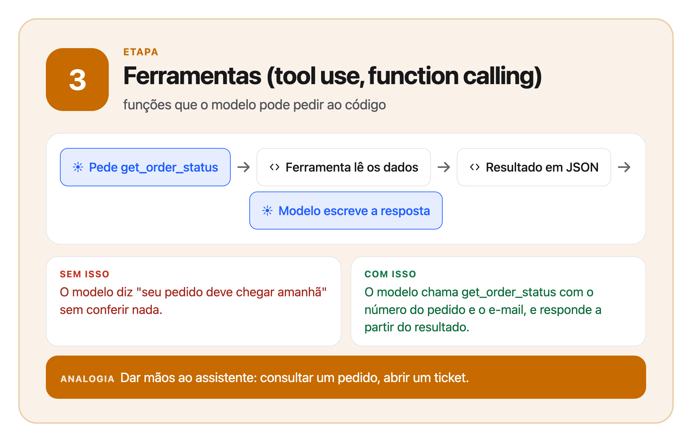

```kotlin
class GetOrderStatusTool(private val orders: OrderGateway) : Tool {
    override val spec = ToolSpec(
        name = "get_order_status",
        description = "Consulta o status e o atraso de um pedido. Exige order_id e email.",
        inputSchema = stringSchema("order_id", "email"),
    )

    override suspend fun run(args: JsonObject): ToolResult {
        val orderId = args.stringArg("order_id") ?: return fail("missing_argument:order_id")
        val email = args.stringArg("email") ?: return fail("missing_argument:email")
        // Uma ferramenta nunca lança exceção: a falha volta como resultado que o modelo lê.
        val order = orders.findOwned(orderId, email) ?: return fail("order_not_found_or_email_mismatch")
        return ok("status" to JsonPrimitive(order.status.wire), "eta" to JsonPrimitive(order.eta.toString()))
    }
}
```

> [!TIP]
> **Dica**
> A descrição faz parte do prompt. Uma descrição vaga faz o modelo escolher a ferramenta errada.

### 04 · RAG: responder com consulta

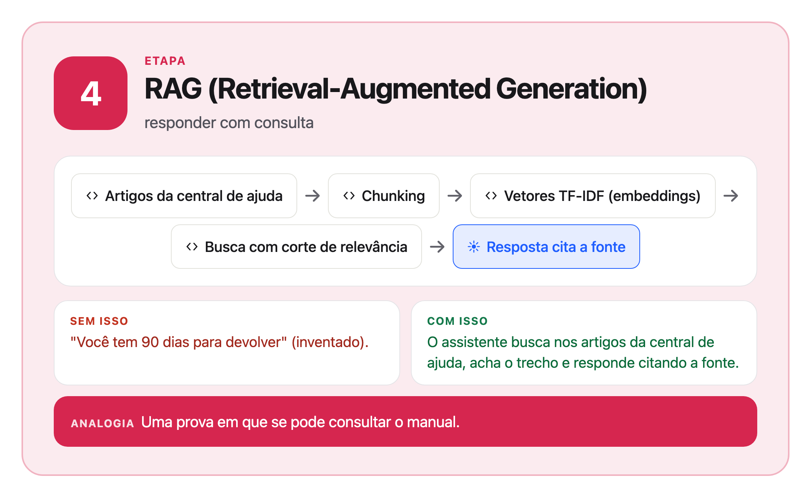

**1** divida os artigos em trechos (chunking) · **2** transforme os trechos em vetores (embeddings TF-IDF) · **3** devolva os mais próximos · **4** descarte tudo abaixo de um corte de relevância.

```kotlin
// SearchKbTool: o corte é o que impede "responder com um trecho sem relação"
val relevant = kb.search(query).filter { it.score >= minScore }    // minScore = 0.25
if (relevant.isEmpty()) return fail("nothing_relevant_found")        // diga "nada encontrado"
```

> [!WARNING]
> **Alerta**
> Sem corte, a busca sempre devolve *alguma coisa*, e o modelo responde alegremente com ela.

### 05 · MCP: ferramentas servidas por programas separados

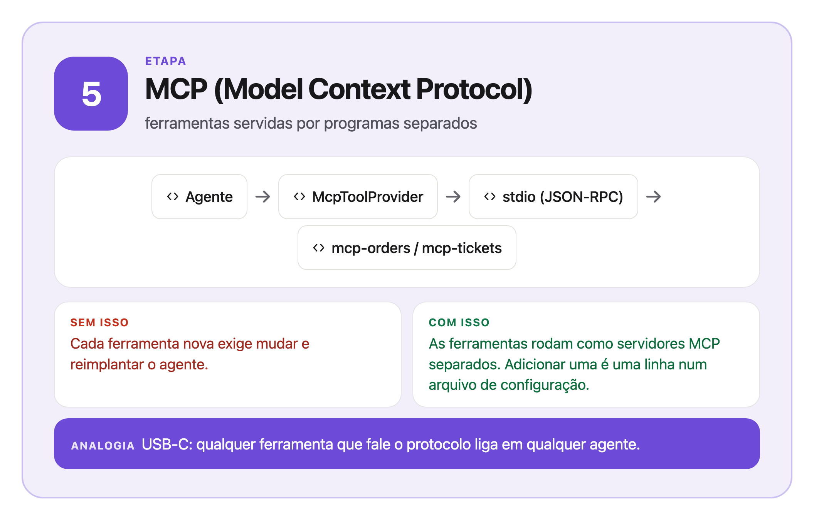

```json
{
  "servers": [
    { "name": "orders",  "command": ["mcp-orders/build/install/mcp-orders/bin/mcp-orders"],   "env": { "DATA_DIR": "data" } },
    { "name": "tickets", "command": ["mcp-tickets/build/install/mcp-tickets/bin/mcp-tickets"], "env": { "DATA_DIR": "data" } }
  ]
}
```

```kotlin
// Uma ferramenta remota pode estourar o tempo, morrer ou lançar exceção. O agente nunca pode travar nem quebrar.
override suspend fun run(args: JsonObject): ToolResult = try {
    withTimeout(timeoutMs) { connection.callTool(spec.name, args) }
} catch (e: Exception) {
    ToolResult("error: ${e.message}", isError = true)
}
```

Adicionar um servidor é uma linha de configuração. O código do agente não muda.

> [!WARNING]
> **Alerta**
> Num servidor MCP stdio, o `stdout` **é** o protocolo. Um `println` solto corrompe a conversa.

### 06 · Orquestração multiagente

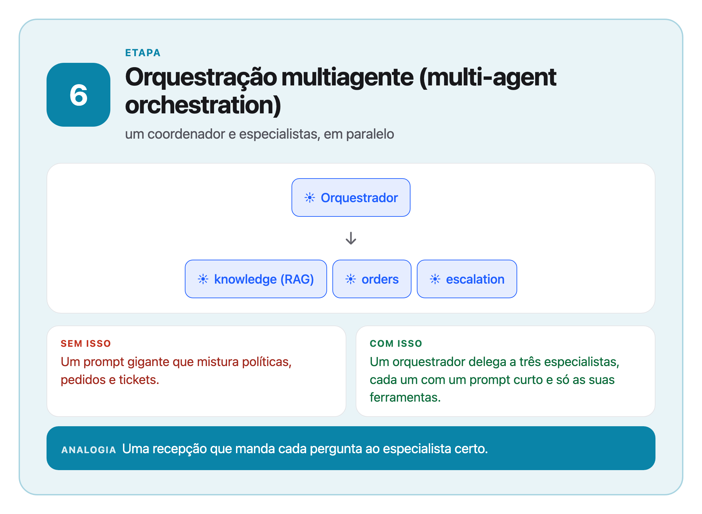

Um agente com todas as ferramentas se confunde. Um orquestrador delega, e cada especialista só enxerga as suas ferramentas.

```json
{
  "agents": {
    "knowledge":  { "tools": ["search_kb"] },
    "orders":     { "tools": ["get_order_status", "track_shipment"] },
    "escalation": { "tools": ["create_ticket"] }
  }
}
```

Um especialista é exposto ao orquestrador **como uma ferramenta**, e um agente novo é criado a cada chamada, então os históricos nunca se misturam.

### 07 · Guardrails: regras que o modelo não consegue pular

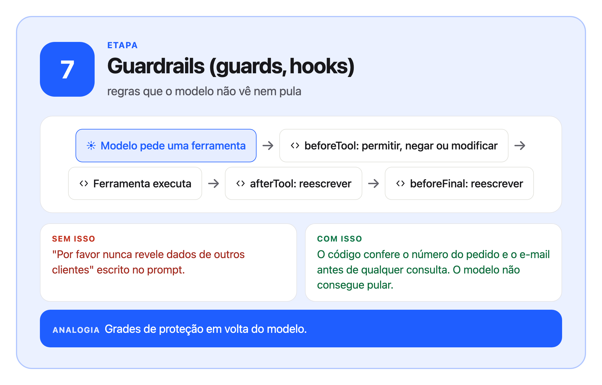

```kotlin
class IdentityGate : Hook {
    override val covers = setOf("get_order_status", "track_shipment")

    override suspend fun beforeTool(agent: String, tool: ToolSpec, args: JsonObject): Decision = when {
        // Sem número de pedido válido: o modelo nunca chega à ferramenta.
        args.stringArg("order_id")?.let { digits.matches(it) } != true ->
            Decision.Deny("order_id is missing or invalid. Ask the customer for the order number.")
        args.stringArg("email")?.let { Patterns.email.matches(it) } != true ->
            Decision.Deny("email is missing or invalid. Ask the customer for the email used in the purchase.")
        else -> Decision.Allow
    }
}
```

Outro, para uma classe real de bug: duas chamadas `create_ticket` em paralelo.

```kotlin
// Um ticket aberto por cliente. Uma criação em andamento RESERVA o cliente,
// então duas chamadas simultâneas não passam as duas.
override suspend fun beforeTool(agent: String, tool: ToolSpec, args: JsonObject): Decision {
    val email = customerOf(tool, args) ?: return Decision.Allow
    return lock.withLock {
        if (email in inFlight) return@withLock Decision.Deny("A ticket for this customer is already being created.")
        tickets.findOpenByEmail(email)?.let { return@withLock Decision.Deny("Ticket ${it.ticketId} is already open.") }
        inFlight += email
        Decision.Allow
    }
}
```

> [!WARNING]
> **Alerta**
> "Por favor nunca crie tickets duplicados" no prompt é um desejo. O `Mutex` é uma garantia.

### 08 · Saída estruturada e validação

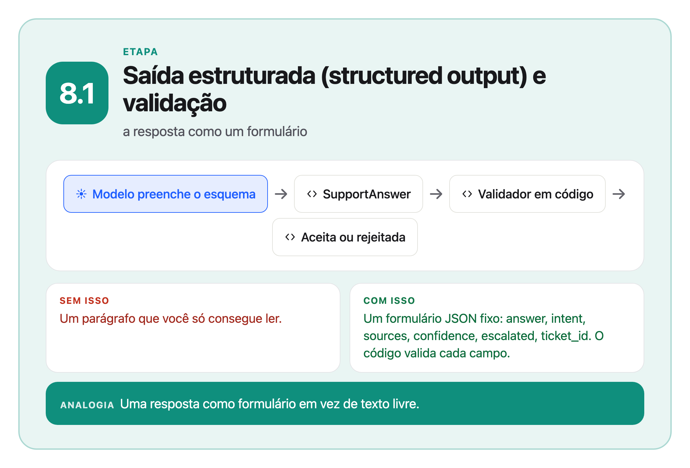

A resposta final é um formulário JSON. Depois o código comum confere o que um esquema não consegue.

```kotlin
fun problems(answer: SupportAnswer, evidence: List<String>): List<String> = buildList {
    val results = evidence.joinToString("\n")
    if (answer.intent !in INTENTS) add("invalid intent: ${answer.intent}")
    if (answer.confidence !in 0.0..1.0) add("confidence out of range 0..1")
    answer.ticketId?.let { ticket ->
        // um id de ticket inventado é rejeitado: ele precisa aparecer no que as ferramentas devolveram
        if (ticket !in results) add("ticket $ticket does not appear in the tool results (invented?)")
    }
    answer.sources.filter { !results.contains(it, ignoreCase = true) }
        .forEach { add("source \"$it\" does not appear in the tool results") }
}
```

### 09 · Produtor e revisor, com limite

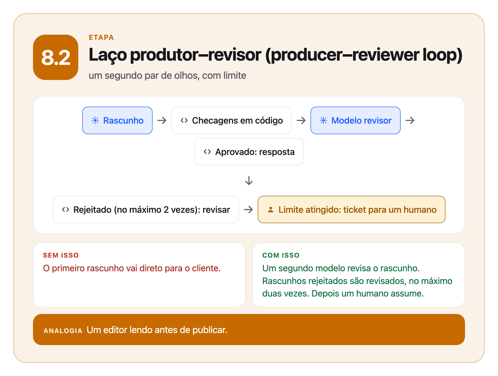

```kotlin
suspend fun answer(question: String): SupportAnswer {
    producer.run(question)
    for (round in 0..maxRevisions) {                                 // no máximo 2 revisões
        val draft = decode(producer.finish(SupportAnswerSchema.output))
        val problems = validator.problems(draft, producer.evidence)  // barato e exato: código primeiro
            .ifEmpty { review(question, draft) }                     // depois um modelo julga as afirmações
        if (problems.isEmpty()) return draft
        producer.followUp("A reviewer rejected your answer. Fix these points:\n" + problems.joinToString("\n"))
    }
    return escalate(question)                                        // o CÓDIGO abre o ticket, não o modelo
}
```

> [!TIP]
> **Conclusão**
> O revisor também é um modelo. Por isso as checagens determinísticas rodam **primeiro**.

### 10 · Observabilidade: uma caixa-preta de avião

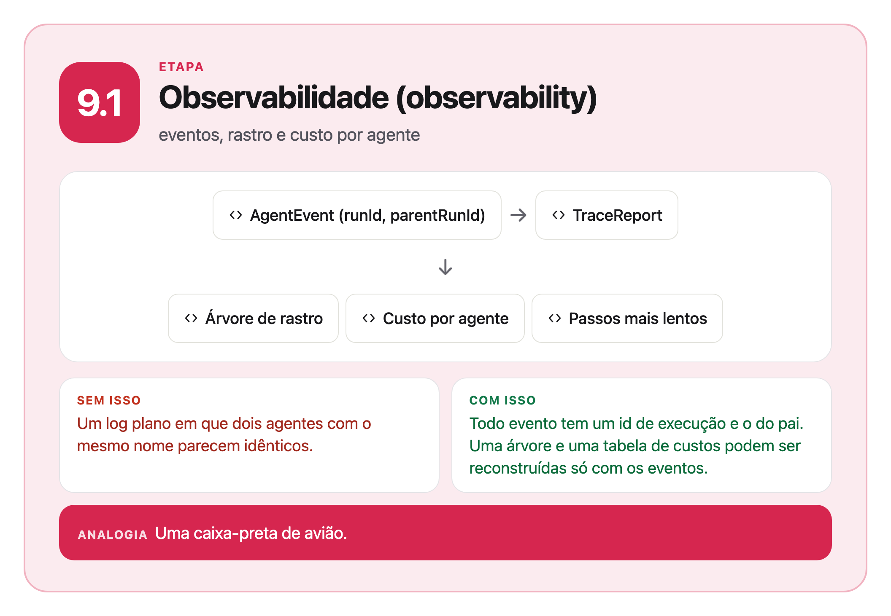

Todo evento carrega um `runId` e um `parentRunId`, então dá para reconstruir uma árvore:

```text
[orchestrator] r1
  model call: 900 in / 80 out tokens, 700 ms
  tool orders: 1300 ms
    [orders] r2
      model call: 400 in / 40 out tokens, 500 ms
```

### 11 · Evals: uma prova com gabarito

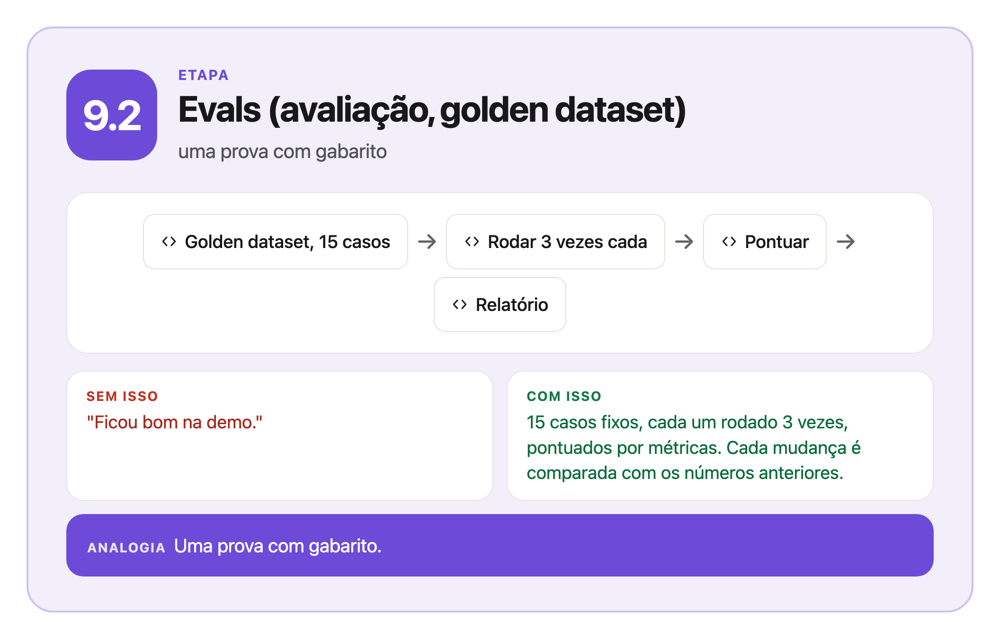

15 casos dourados, cada um rodado 3 vezes, porque o mesmo código deu resultados diferentes.

Os evals acharam o que code review nunca acharia: duas regras que se contradiziam, um revisor que inventava objeções e um erro de roteamento que se repetia sempre. Cerca de 30 centavos, uma tarde.

### 12 · Servidor e app

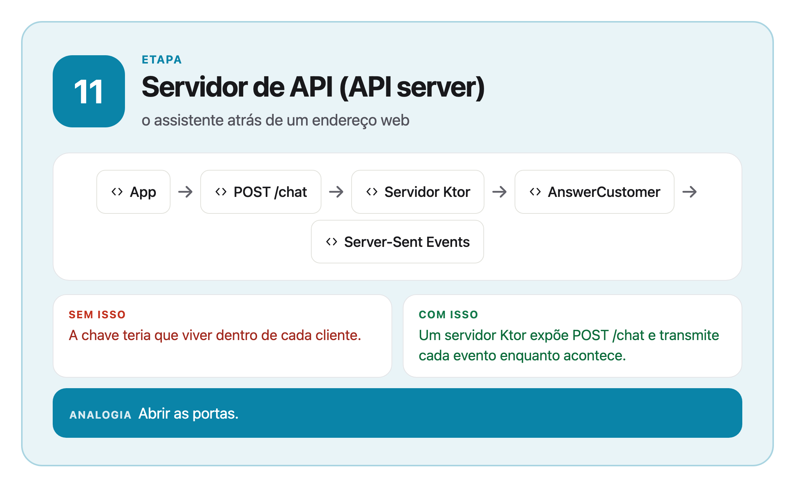

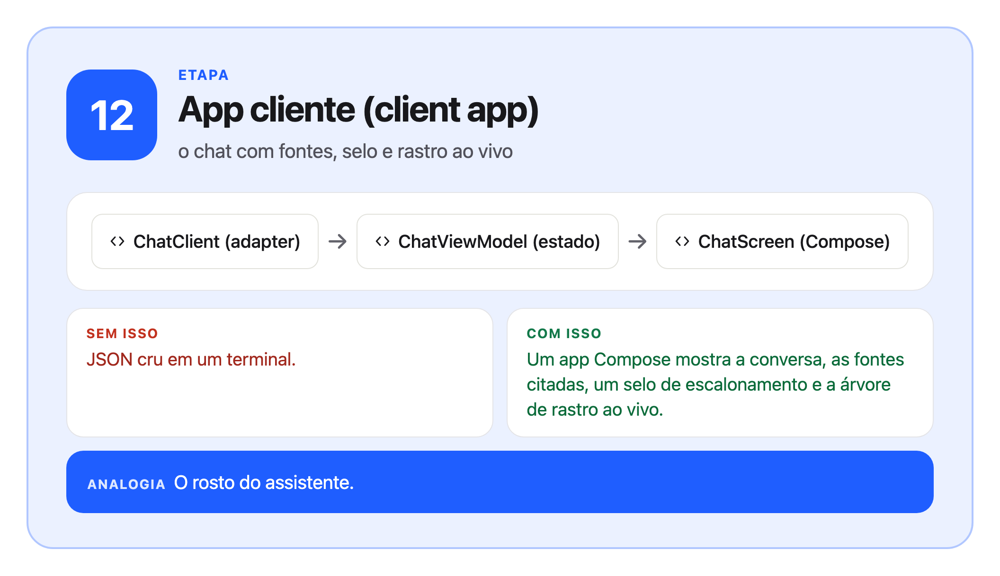

```kotlin
// POST /chat transmite um quadro Server-Sent Events por AgentEvent.
post("/chat") {
    val question = receiveQuestion() ?: return@post call.respondText("bad request", status = BadRequest)
    call.respondTextWriter(ContentType.Text.EventStream) {
        answerCustomer(question).collect { event ->
            write(ServerSentEvents.frame(event))
            flush()                      // o flush é o que torna o rastro ao vivo possível
        }
    }
}
```

A chave da API vive só no servidor. O app Compose desenha a conversa, as fontes, um selo de escalonamento e o rastro ao vivo.

---

---

## 4️⃣ Anatomia de uma execução real

O cliente escreve: `"My order 1042 has not arrived. My email is ana@example.com"`.

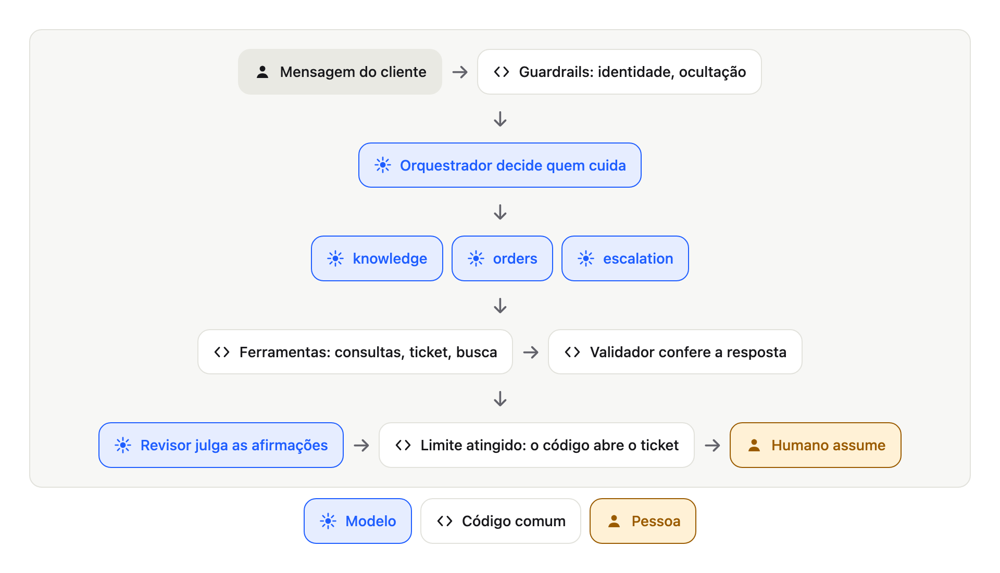

Este é o rastro real no terminal (resumido):

```text
[orchestrator] calls orders {"task":"Check the status, tracking and delivery progress..."}
[orders] calls get_order_status {"order_id":"1042","email":"ana@example.com"}
[orders] calls track_shipment   {"order_id":"1042","email":"ana@example.com"}   <- em paralelo
[orders] get_order_status finished in 12 ms: {"ok":true,"status":"in_transit","late":true,"days_late":10}
[orchestrator] calls escalation {"task":"Delayed order. Order number: 1042 ..."}
[escalation] create_ticket finished in 17 ms: {"ok":true,"ticket_id":"TCK-1001"}
review round 1: rejected (4 problems)
review round 2: approved
```

> [!TIP]
> **Eficiência e custo**
> 12 chamadas ao modelo, cerca de 15 mil tokens de entrada e 2 mil de saída. Custo: **US$ 0,0025** (um quarto de centavo) com `claude-haiku-5-5`.

---

## 5️⃣ Evals: como provar que o agente funciona

Se você não mede o agente, você só tem opiniões. O `eval` roda um golden dataset de 15 casos, 3 vezes cada, a cada mudança.

| Métrica | Antes | Depois | O que significa na prática |
|---|---|---|---|
| Acerto de roteamento | 100% | 100% | O orquestrador manda a dúvida ao especialista certo |
| Groundedness | 100% | 100% | Nenhuma resposta inventa fatos fora das fontes |
| Sem vazamento | 100% | 100% | Dados do cliente não aparecem onde não deviam |
| Fatos esperados | 93% | 100% | As informações vitais foram entregues |
| Fontes citadas | 86% | 100% | Dá para ver de onde veio a resposta |
| Precisão de escalonamento | 80% | 100% | Passa a um humano na hora certa |
| Fallback por falha de revisão | 9% | 0% | Respostas refinadas sem estourar o limite |

---

## Testes e containerização

Uma classe de teste por classe de produção. Dublês nas portas. **Zero chamadas de API.**

```kotlin
@Test
fun `given a malformed email when checking an order tool then should deny`() = runTest {
    val decision = gate.beforeTool("orders", spec("get_order_status"),
        argsOf("order_id" to "1042", "email" to "not-an-email"))

    assertIs<Decision.Deny>(decision)
}
```

Um `Dockerfile` multi-stage (compila com o JDK, roda com o JRE):

```dockerfile
# Estágio 1: gera a distribuição com o JDK completo
FROM eclipse-temurin:21-jdk AS build
WORKDIR /src
COPY . .
RUN ./gradlew :server:installDist --no-daemon

# Estágio 2: roda numa imagem JRE pequena
FROM eclipse-temurin:21-jre
WORKDIR /app
COPY --from=build /src/server/build/install/server/ ./
COPY config ./config
COPY data ./data
ENV DATA_DIR=data
EXPOSE 8080
CMD ["bin/server"]
```

---
---

## O preço do "multi"

> [!WARNING]
> **Alerta**
> Uma pergunta de pedido atrasado custou **12 chamadas ao modelo**, cerca de 15.000 tokens de entrada e 10 segundos. Multiagente não é de graça.

Use um agente com ferramentas quando a tarefa é pequena. Divida em especialistas só quando prompts e ferramentas crescem e os papéis são claramente diferentes.

## 🏁 Conclusão provocativa

Engenharia de software não mudou só porque agora usamos IA. Agentes sem **tipagem forte**, **arquitetura limpa**, **guardrails em código** e **avaliação automatizada** são brinquedos imprevisíveis.

A inovação não é o framework da semana. É saber **onde usar o não-determinismo do modelo** e **onde usar o determinismo do código**.

---

### Conclusão

O modelo decide. O seu código age, valida e escala. As regras vivem no código. A qualidade é medida. Os provedores são substituíveis.

**Sua vez**

**1** · Qual regra do seu projeto poderia ser código em vez de prompt? Conte nos comentários.
**2** · Discorda que a maior parte de um agente deva ser determinística? Quero ouvir o contraexemplo.
**3** · Compartilhe com quem está prestes a construir "um agente de IA". Uma estrela no repositório ajuda: github.com/diegoferreiracaetano/dsupport-kt