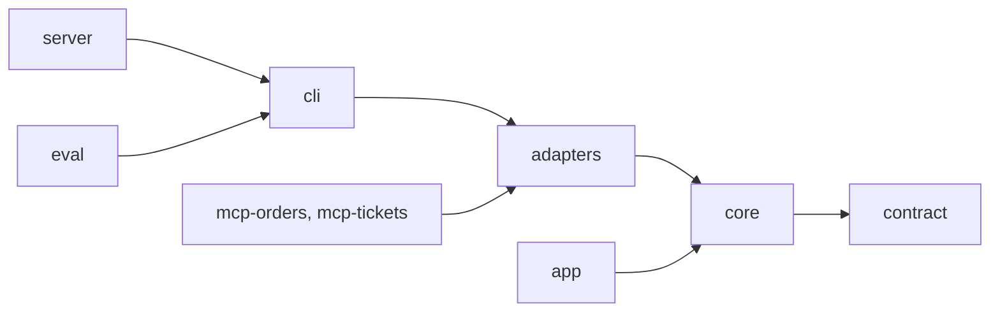
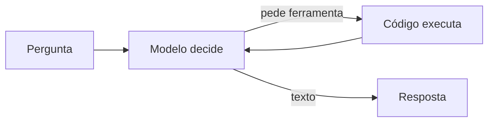
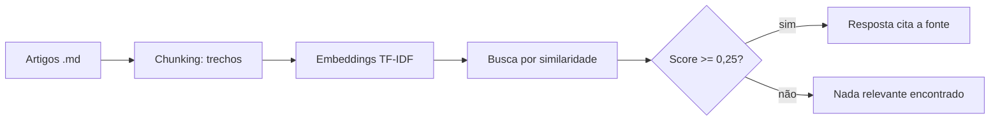
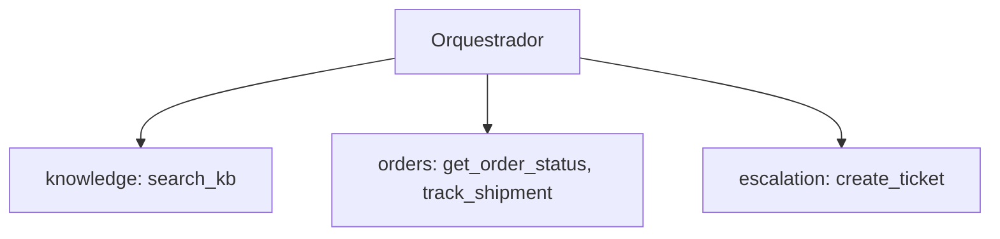
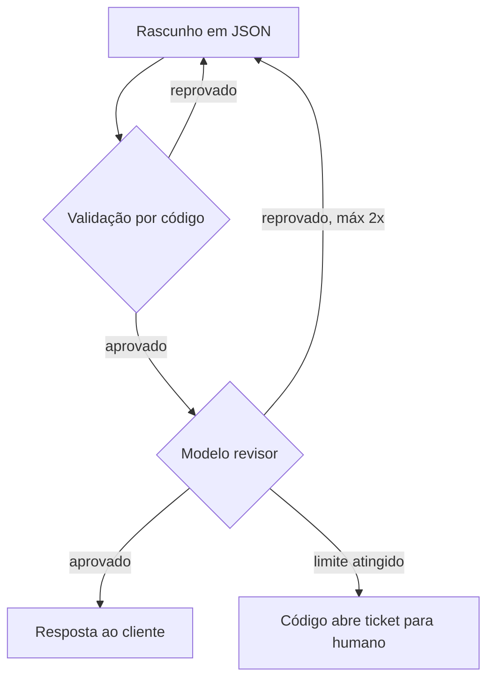
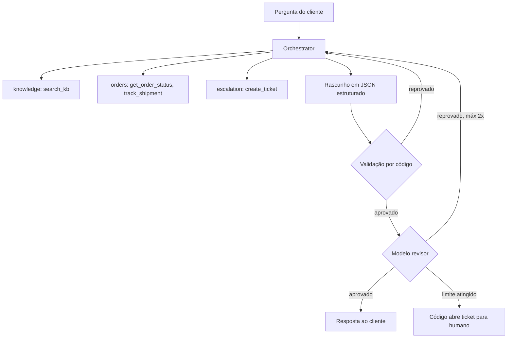

# IA na Prática: Desmistificando RAG, MCP e Multiagentes em Kotlin sem Frameworks "Mágicos"

> [!IMPORTANT]
> **Provocação inicial:** O mercado foi inundado de *buzzwords*: RAG, MCP, arquitetura multiagente, ReAct, guardrails. Todo dia surge um framework prometendo agentes autônomos em duas linhas de código. Mas o que acontece quando você coloca esse "agente de demo" em um suporte ao cliente real? Ele alucina, ignora regras de negócio e vaza dados. Chega de *vibes-based engineering*!

Este artigo mostra um projeto real, o **DSupport**, escrito à mão em Kotlin Multiplatform, sem framework de agentes. Cada conceito vem com o **código verdadeiro** do repositório e uma explicação de como ele funciona, linha por linha.

📦 Código completo: [github.com/diegoferreiracaetano/dsupport-kt](https://github.com/diegoferreiracaetano/dsupport-kt). Cada etapa é uma tag do git (`etapa-1` até `etapa-12`), então você vê o código exato daquele ponto.

**Como ler os trechos de código:** os números ①②③ nos comentários aparecem de novo na explicação logo abaixo, em **🔍 Lendo o código**.

---

## 1️⃣ A Grande Ilusão do "Tudo é LLM": Determinístico vs. Não-Determinístico

Há a ilusão de que o modelo de linguagem deve tomar 100% das decisões de um software. Mas um LLM é um motor **probabilístico**: a mesma entrada pode gerar saídas diferentes. Pedir a ele, por prompt, que jamais exiba um dado sensível é uma roleta-russa.

```text
+-----------------------------------------------------------------------+
|                        SISTEMA HÍBRIDO (DSupport)                      |
+------------------------------------+----------------------------------+
|  Modelo (não-determinístico)       |  Código (determinístico)         |
+------------------------------------+----------------------------------+
|  - entender linguagem natural      |  - validar tipos e regras        |
|  - decidir qual ferramenta chamar  |  - ocultar dados sensíveis       |
|  - rascunhar a resposta            |  - barrar o que não pode passar  |
|  - rotear entre especialistas      |  - testes que rodam offline      |
+------------------------------------+----------------------------------+
```

> [!WARNING]
> **Por que depender só do prompt falha em produção?** Prompt é sugestão, não garantia. Uma injeção de prompt (*prompt injection*) ou uma simples variação estocástica do modelo quebra a regra. O que importa para o negócio tem que ser imposto **em código**.

### O contraste: três jeitos de construir

| Abordagem | O que entrega | Onde quebra |
| :--- | :--- | :--- |
| **100% determinístico** (`if/else`, máquinas de estado) | Previsível, rápido, de custo zero | Não entende paráfrase; a lista de regras cresce para sempre |
| **100% modelo** (framework "mágico") | Flexível, parece inteligente | Respostas imprevisíveis, laços infinitos, custo fora de controle |
| **Híbrido (DSupport)** | O modelo entende e escolhe; o código valida e barra | Custa mais que um `if`: precisa de evals e rastro |

### Na prática: onde o determinístico erra

Esta é a primeira coisa que qualquer um tentaria, e é uma ótima ideia para perguntas previsíveis:

```kotlin
// Um roteador determinístico (ilustração, não está no repositório)
fun route(message: String): Intent = when {
    "refund" in message.lowercase()                     -> Intent.POLICY   // ①
    Regex("""order\s*#?\d+""").containsMatchIn(message) -> Intent.ORDER    // ②
    else                                                -> Intent.OTHER    // ③
}
```

**🔍 Lendo o código**
1. **①** Procura a palavra exata "refund". "Quero meu dinheiro de volta" não contém essa palavra.
2. **②** Exige o padrão "order 1042". "Cadê aquilo que comprei na segunda?" não casa.
3. **③** Tudo que não foi previsto cai aqui, e cai em silêncio.

```text
"my package never showed up"           -> OTHER   (errado)
"where is the thing I bought Monday?"  -> OTHER   (errado)
"quero meu dinheiro de volta"          -> OTHER   (errado)
```

> [!TIP]
> O determinístico falha na **linguagem**, não na lógica. O agente falha na **confiança**. A pergunta certa não é "IA ou código?", e sim **"o que cada um faz melhor?"**. No DSupport, **5 papéis usam modelo** e **14 peças são código comum** (guardrails, validador, busca TF-IDF, ferramentas, transporte MCP, rastro, pontuação dos evals e outras).

---

## 2️⃣ A Arquitetura do Projeto DSupport: Separação Limpa de Responsabilidades

Para ter testabilidade e independência de fornecedor (*vendor lock-in*), o DSupport usa **Clean Architecture** e **Ports & Adapters** em Kotlin Multiplatform. A regra de ouro: **as dependências apontam para dentro**.



### 🧱 Como os módulos são separados

1. **`contract`**: os tipos compartilhados (`SupportAnswer`, `AgentEvent`). Sem dependências externas.
2. **`core`**: o coração. Agent loop, orquestração, guardrails, revisão e as **portas** (interfaces). Ele não sabe o que é HTTP, Anthropic ou JSON.
3. **`adapters`**: implementam as portas. Cliente Anthropic, motor de RAG, arquivos JSON, cliente MCP. Trocar o Claude por outro modelo é escrever **um adapter novo**, sem tocar no `core`.
4. **`mcp-orders` e `mcp-tickets`**: servidores independentes que falam o protocolo MCP.
5. **`cli`, `server`, `app`**: pontos de entrada (terminal, API Ktor com SSE, app Compose no desktop e no iPhone).
6. **`eval`**: a suíte de avaliação com *golden dataset*.

### Uma porta de verdade: o que o `core` conhece do modelo

```kotlin
interface LlmClient {
    suspend fun next(request: LlmRequest): LlmReply                                      // ①
    suspend fun structured(request: LlmRequest, schema: OutputSchema): StructuredReply   // ②
}
```

**🔍 Lendo o código**
1. **①** `next` devolve **texto** ou **um pedido de ferramenta** (`LlmReply.Text` ou `LlmReply.ToolCalls`). É a base do agent loop.
2. **②** `structured` obriga o modelo a preencher um formulário JSON (veremos na seção 3).
3. Não existe nenhum `import` de provedor aqui. O `AnthropicLlmClient`, no módulo `adapters`, implementa esta interface e traduz tudo para o JSON da Anthropic, com 2 tentativas em erros 429 e 5xx.

> [!NOTE]
> **Por que isso importa?** Os mais de 380 testes do projeto rodam **offline**, com dublês no lugar do modelo. Nenhum teste gasta um centavo de API.

---

## 3️⃣ Os Conceitos Mapeados na Prática (da Teoria ao Código)

### 🔹 Agent loop: o modelo decide, o código age (`etapa-1`)

**Em uma frase:** um `for` com limite. O modelo pede uma ferramenta, o código executa, o resultado volta, e o ciclo se repete até haver uma resposta.



```kotlin
private suspend fun loop(): String {
    repeat(maxTurns) {                                                              // ①
        val reply = llm.next(LlmRequest(system, history.toList(), specs))           // ②
        when (reply) {
            is LlmReply.Text -> return finalAnswer(reply.text)                      // ③
            is LlmReply.ToolCalls -> {
                history += Message.AssistantToolCalls(reply.calls)
                val results = coroutineScope {
                    reply.calls.map { call -> async { execute(call.tool, call.args) } }.awaitAll()   // ④
                }
                reply.calls.zip(results).forEach { (call, result) ->
                    history += Message.ToolResult(call.id, call.tool, result.content, result.isError) // ⑤
                }
            }
        }
    }
    return "Turn limit of $maxTurns reached. Escalating to a human agent."          // ⑥
}
```

**🔍 Lendo o código**
1. **①** `repeat(maxTurns)`: o laço **sempre** tem limite. Sem ele, um modelo confuso chama ferramentas para sempre.
2. **②** A cada volta, o histórico inteiro é enviado de novo, junto com a lista de ferramentas disponíveis.
3. **③** Se o modelo respondeu com **texto**, acabou. Antes de devolver, a resposta passa pelos guardrails (`finalAnswer`).
4. **④** Se pediu **ferramentas**, elas rodam **em paralelo** (`async` + `awaitAll`). Duas consultas independentes levam o tempo da mais lenta.
5. **⑤** Os resultados entram no histórico **na mesma ordem dos pedidos**, porque a API do modelo exige essa correspondência.
6. **⑥** Estourou o limite? O código devolve uma mensagem de escalonamento. O modelo não decide isso.

> [!CAUTION]
> O modelo **nunca executa nada**. Ele só **pede**. Quem executa, valida e decide o que volta é o seu código.

---

### 🔹 Tools (function calling): dando mãos ao modelo (`etapa-3`)

Uma ferramenta é uma função com **nome**, **descrição** e **esquema de entrada** (JSON Schema). O modelo só vê isso; o código faz o trabalho.

```kotlin
interface Tool {
    val spec: ToolSpec                                   // ① nome, descrição, schema
    suspend fun run(args: JsonObject): ToolResult        // ② executa
}
```

```kotlin
override suspend fun run(args: JsonObject): ToolResult {
    val orderId = args.stringArg("order_id") ?: return fail("missing_argument:order_id")     // ①
    val email = args.stringArg("email") ?: return fail("missing_argument:email")
    val order = orders.findOwned(orderId, email)                                            // ②
        ?: return fail("order_not_found_or_email_mismatch")
    val late = order.status == OrderStatus.IN_TRANSIT && order.eta < today()                // ③
    return ok("status" to JsonPrimitive(order.status.wire), "late" to JsonPrimitive(late))  // ④
}
```

**🔍 Lendo o código (`GetOrderStatusTool`, trecho resumido)**
1. **①** Argumento faltando? Devolve um **resultado de erro legível**, não uma exceção. O modelo lê `missing_argument:email` e **pergunta o e-mail ao cliente**.
2. **②** `findOwned` só devolve o pedido se o número **e** o e-mail baterem. Esse é o primeiro cadeado contra vazamento de dados.
3. **③** O atraso é **calculado em código**, a partir da data estimada. O modelo não "acha" que está atrasado: ele lê `late: true`.
4. **④** O retorno é JSON curto e já no formato certo, sem despejar o banco inteiro no contexto.

> [!TIP]
> A **descrição** da ferramenta faz parte do prompt. Descrição vaga faz o modelo escolher a ferramenta errada. Escreva-a como se fosse instrução para um estagiário.

---

### 🔹 RAG (Retrieval-Augmented Generation): responder com consulta (`etapa-4`)

Em vez de deixar o modelo inventar a política de devolução, o RAG **busca** trechos na central de ajuda e o obriga a responder **só com o que foi encontrado**.



```kotlin
class SearchKbTool(
    private val kb: KnowledgeSearch,
    private val minScore: Double = 0.25,                                  // ①
) : Tool {
    override suspend fun run(args: JsonObject): ToolResult {
        val query = args.stringArg("query") ?: return fail("missing_argument:query")
        val relevant = kb.search(query).filter { it.score >= minScore }   // ②
        if (relevant.isEmpty()) return fail("nothing_relevant_found")     // ③
        val results = relevant.map {
            buildJsonObject { put("doc_id", it.docId); put("title", it.title); put("snippet", it.snippet); put("score", it.score) }  // ④
        }
        return ok("results" to JsonArray(results))
    }
}
```

**🔍 Lendo o código**
1. **①** O **corte de relevância** é a peça mais importante. Sem ele, a busca sempre devolve *alguma coisa*.
2. **②** Só passa quem tem similaridade suficiente com a pergunta.
3. **③** Nada relevante? Resposta **honesta**: "nada encontrado". O especialista de conhecimento é instruído a responder `NO_ANSWER` nesse caso, em vez de inventar.
4. **④** Cada resultado traz o **título do artigo**. É assim que a resposta final consegue **citar a fonte**, e o validador (seção abaixo) confere que a fonte citada realmente veio da busca.

Os artigos são divididos por seção (`MarkdownChunker`) e transformados em vetores com **TF-IDF**, um peso simples de palavras. Existe um `VoyageEmbedder` opcional para busca semântica. Repare: a busca em si é **código determinístico**, e funciona sem chave de API.

> [!WARNING]
> RAG sem corte de relevância é a causa nº 1 de "respostas confiantes baseadas em um trecho que não tem nada a ver".

---

### 🔹 MCP (Model Context Protocol): ferramentas em processos separados (`etapa-5`)

O MCP é um padrão aberto: as ferramentas vivem em **outros programas** e falam JSON-RPC. Neste projeto, via **stdio** com o SDK oficial do Kotlin: o cliente inicia o servidor como processo filho. Uma sessão tem 3 mensagens: `initialize`, `tools/list`, `tools/call`.

```json
{
  "servers": [
    { "name": "orders",  "command": ["mcp-orders/build/install/mcp-orders/bin/mcp-orders"],   "env": { "DATA_DIR": "data" } },
    { "name": "tickets", "command": ["mcp-tickets/build/install/mcp-tickets/bin/mcp-tickets"], "env": { "DATA_DIR": "data" } }
  ]
}
```

Do lado do servidor, **qualquer lista de `Tool`** vira um servidor MCP:

```kotlin
server.addTool(
    name = spec.name,
    description = spec.description,
    inputSchema = ToolSchema(properties = spec.inputSchema["properties"] as? JsonObject, required = ...),   // ①
    toolAnnotations = ToolAnnotations(readOnlyHint = spec.readOnly, destructiveHint = spec.destructive),    // ②
) { request ->
    val result = tool.run(request.arguments ?: JsonObject(emptyMap()))                                       // ③
    CallToolResult(content = listOf(TextContent(result.content)), isError = result.isError)                  // ④
}
```

**🔍 Lendo o código (servidor)**
1. **①** O mesmo `ToolSpec` das ferramentas locais é convertido para o esquema do protocolo.
2. **②** Os sinalizadores `readOnly` e `destructive` seguem junto: um cliente pode usá-los para pedir confirmação.
3. **③** A ferramenta é a **mesma classe** de antes. Nada foi reescrito para virar remota.
4. **④** O resultado volta como texto, com a marca de erro.

Do lado do cliente, a falha remota **nunca** pode travar o agente:

```kotlin
override suspend fun run(args: JsonObject): ToolResult = try {
    withTimeout(timeoutMs) { connection.callTool(spec.name, args) }     // ①
} catch (e: CancellationException) {
    if (e is TimeoutCancellationException) ToolResult("error: ${spec.name} timed out", isError = true) else throw e   // ②
} catch (e: Exception) {
    ToolResult("error: ${e.message}", isError = true)                    // ③
}
```

**🔍 Lendo o código (cliente)**
1. **①** Toda chamada remota tem **timeout**. Servidor lento não congela o laço.
2. **②** Timeout vira **resultado de erro**. O cancelamento de verdade (`CancellationException`) é repassado, para não quebrar as corrotinas.
3. **③** Servidor morto ou exceção: também vira erro que o modelo consegue ler e contornar.

> [!TIP]
> **Benefício do MCP:** adicionar o servidor de tickets é **uma linha no `config/mcp-servers.json`**. O código do agente não muda: ele não sabe se a ferramenta é local ou remota.

> [!CAUTION]
> Em um servidor MCP via stdio, o `stdout` **é o protocolo**. Um `println` solto corrompe a conversa. Por isso o servidor redireciona `System.out` para `System.err`.

---

### 🔹 Orquestração multiagente: um orquestrador, três especialistas (`etapa-6`)

Em vez de um "super prompt" gigante, um **orquestrador** com perfil de especialista sênior em suporte delega para agentes com **prompt curto** e **só as ferramentas necessárias**.



Quem pode usar o quê é **configuração**, não código:

```json
{
  "agents": {
    "knowledge":  { "tools": ["search_kb"] },
    "orders":     { "tools": ["get_order_status", "track_shipment"] },
    "escalation": { "tools": ["create_ticket"] }
  }
}
```

E cada especialista é exposto ao orquestrador **como se fosse uma ferramenta**:

```kotlin
class SubAgentTool(
    private val name: String,
    description: String,
    private val newAgent: () -> Agent,                           // ①
) : Tool {
    override val spec = ToolSpec(name, description, stringSchema("task"))

    override suspend fun run(args: JsonObject): ToolResult {
        val task = args.stringArg("task") ?: return fail("missing_argument:task")
        return try {
            ToolResult(newAgent().run(task))                     // ②
        } catch (e: CancellationException) {
            throw e
        } catch (e: Exception) {
            ToolResult("error: specialist '$name' failed: ${e.message}", isError = true)   // ③
        }
    }
}
```

**🔍 Lendo o código**
1. **①** Recebe uma **fábrica** de agentes, não um agente. Cada chamada cria um agente **novo**, porque o agente guarda histórico e duas chamadas paralelas não podem compartilhá-lo.
2. **②** Rodar o especialista é só chamar `run(task)`. Para o orquestrador, isso é uma ferramenta como qualquer outra.
3. **③** Se o especialista falhar, o orquestrador recebe um erro e segue em frente.

O orquestrador não tem ferramentas de dados. O perfil dele, no prompt, começa assim:

```text
You are a senior customer support specialist and the coordinator of a small team. [...]
You never look up data yourself: you decide who handles each part and always delegate to a specialist.
[...]
- Never promise anything the specialists did not confirm: no dates, refunds or outcomes of your own.
```

> [!WARNING]
> Se você der as ferramentas de dados também ao orquestrador, ele **pula a delegação** e o desenho desmorona. Por isso o `DSupportAssembly` falha ao montar o sistema se o orquestrador tiver ferramentas.

---

### 🔹 Guardrails: regras que o modelo não vê nem pula (`etapa-7`)

Guardrails são **código determinístico** que roda em 3 pontos fixos do laço. Todo guardrail implementa esta interface:

```kotlin
interface Hook {
    val covers: Set<String> get() = emptySet()                                                              // ①
    suspend fun beforeTool(agent: String, tool: ToolSpec, args: JsonObject): Decision = Decision.Allow      // ②
    suspend fun afterTool(agent: String, tool: ToolSpec, args: JsonObject, result: ToolResult): ToolResult = result   // ③
    suspend fun beforeFinal(agent: String, history: List<Message>, text: String): String = text            // ④
}
```

**🔍 Lendo o código**
1. **①** Quais ferramentas o guardrail protege.
2. **②** **Antes** da ferramenta: pode **permitir**, **negar** ou **modificar** os argumentos.
3. **③** **Depois** da ferramenta: pode **reescrever o resultado** (por exemplo, ocultar dados pessoais).
4. **④** **Antes da resposta final**: pode reescrevê-la.

Um exemplo concreto: o `IdentityGate` só deixa consultar um pedido com número e e-mail válidos.

```kotlin
override suspend fun beforeTool(agent: String, tool: ToolSpec, args: JsonObject): Decision = when {
    tool.name !in covers -> Decision.Allow                                                                   // ①
    args.stringArg("order_id")?.let { digits.matches(it) } != true ->
        Decision.Deny("order_id is missing or invalid. Ask the customer for the order number.")              // ②
    args.stringArg("email")?.let { Patterns.email.matches(it) } != true ->
        Decision.Deny("email is missing or invalid. Ask the customer for the email used in the purchase.")
    else -> Decision.Allow                                                                                   // ③
}
```

**🔍 Lendo o código**
1. **①** Outras ferramentas passam direto.
2. **②** A negação carrega uma **instrução para o modelo** ("peça o número ao cliente"). O modelo lê o motivo e age em vez de ficar tentando de novo.
3. **③** Só chega à ferramenta quem passou nas duas verificações. O modelo **não consegue contornar**: o guardrail roda no código, não no prompt.

E o caso que prova que prompt não basta: **duas chamadas paralelas de `create_ticket`**.

```kotlin
override suspend fun beforeTool(agent: String, tool: ToolSpec, args: JsonObject): Decision {
    val email = customerOf(tool, args) ?: return Decision.Allow
    return lock.withLock {                                                                         // ①
        if (email in inFlight) {
            return@withLock Decision.Deny("A ticket for this customer is already being created. Do not open another.")  // ②
        }
        val existing = tickets.findOpenByEmail(email)
        if (existing != null) {
            return@withLock Decision.Deny("Ticket ${existing.ticketId} is already open for this customer. [...]")        // ③
        }
        inFlight += email                                                                          // ④
        Decision.Allow
    }
}
```

**🔍 Lendo o código (`TicketDedup`)**
1. **①** Um `Mutex` garante que só uma chamada por vez entra nesta checagem.
2. **②** Já tem uma criação **em andamento** para esse cliente? Nega.
3. **③** Já existe ticket **aberto**? Nega e diz o número, para o modelo informá-lo ao cliente.
4. **④** Antes de liberar, **reserva** o cliente. É isso que impede que duas chamadas simultâneas passem as duas.

> [!CAUTION]
> "Por favor, nunca crie tickets duplicados" no prompt é um **desejo**. O `Mutex` é uma **garantia**.

Como os guardrails entram no laço (trecho de `Agent.guarded`):

```kotlin
for (hook in hooks) {
    when (val decision = hook.beforeTool(name, tool.spec, args)) {
        Decision.Allow -> Unit
        is Decision.Deny -> return ToolResult("blocked by ${hook.name}: ${decision.reason}", isError = true)   // ①
        is Decision.Modify -> args = decision.args                                                             // ②
    }
}
```

1. **①** Negado: a ferramenta **nem roda**, e o modelo recebe o motivo.
2. **②** Modificado: a ferramenta roda com os argumentos corrigidos.

---

### 🔹 Saída estruturada e validação em código (`etapa-8.1`)

A resposta final **não é um parágrafo**: é um formulário JSON.

```kotlin
data class SupportAnswer(
    val answer: String = "",
    val intent: String = "other",
    val sources: List<String> = emptyList(),
    val confidence: Double = 0.0,
    val escalated: Boolean = false,
    @SerialName("ticket_id") val ticketId: String? = null,
)
```

Mas um esquema só garante o **formato**, não a **verdade**. Quem confere a verdade é o código:

```kotlin
fun problems(answer: SupportAnswer, evidence: List<String>): List<String> = buildList {
    val results = evidence.joinToString("\n")                                                      // ①
    if (answer.intent !in INTENTS) add("invalid intent: ${answer.intent}")                         // ②
    if (answer.confidence !in 0.0..1.0) add("confidence out of range 0..1: ${answer.confidence}")  // ③
    answer.ticketId?.let { ticket ->
        if (ticket !in results) add("ticket $ticket does not appear in the tool results (invented?)")   // ④
        if (ticket !in answer.answer) add("ticket $ticket is missing from the customer-facing text")
    }
    answer.sources.filter { !results.contains(it, ignoreCase = true) }
        .forEach { add("source \"$it\" does not appear in the tool results") }                     // ⑤
}
```

**🔍 Lendo o código**
1. **①** `evidence` é tudo que as ferramentas devolveram naquela conversa: é a **fonte da verdade**.
2. **②** A intenção precisa estar na lista fechada (`policy`, `order`, `return`, `complaint`, `other`).
3. **③** O esquema JSON não expressa intervalo, então a faixa de confiança é checada aqui.
4. **④** **Ticket inventado é rejeitado:** o número precisa ter aparecido no retorno da ferramenta, e também precisa estar no texto que o cliente vai ler.
5. **⑤** **Fonte inventada é rejeitada:** só vale citar o que a busca realmente devolveu.

Cada problema encontrado é uma frase em inglês, escrita para o **modelo ler e corrigir**.

---

### 🔹 Laço produtor-revisor, com limite (`etapa-8.2`)

Um segundo modelo revisa o rascunho. Mas **o revisor também é um modelo**, por isso o código confere primeiro:

```kotlin
suspend fun answer(question: String): SupportAnswer {
    producer.run(question)
    for (round in 0..maxRevisions) {                                                                  // ①
        val draft = decode(producer.finish(SupportAnswerSchema.output))                               // ②
        val problems = validator.problems(draft, producer.evidence).ifEmpty { review(question, draft) }  // ③
        events.emit(AgentEvent.ReviewRound(round + 1, problems.isEmpty(), problems))                  // ④
        if (problems.isEmpty()) return draft                                                          // ⑤
        producer.followUp("A reviewer rejected your answer. Fix these points and answer the customer again:\n" +
            problems.joinToString("\n") { "- $it" })                                                  // ⑥
    }
    return escalate(question, intent)                                                                 // ⑦
}
```

**🔍 Lendo o código**
1. **①** No máximo `maxRevisions` (2) correções. É o **limite** que impede o laço infinito.
2. **②** O produtor entrega o rascunho no formato estruturado.
3. **③** **Primeiro o código** (barato e exato). **Só se passar**, o modelo revisor julga as afirmações.
4. **④** Cada rodada vira um evento, e aparece no rastro.
5. **⑤** Aprovado: devolve.
6. **⑥** Rejeitado: os problemas voltam ao produtor, com instruções para corrigir.
7. **⑦** Estourou o limite? **O código** abre o ticket para um humano. O modelo não decide escalar.



---

### 🔹 Observabilidade: uma caixa-preta de avião (`etapa-9.1`)

Com agentes em paralelo, "deu errado" não basta. Cada evento carrega um `runId` e o `parentRunId`, e a árvore se reconstrói sozinha. O truque: o pai viaja no **contexto da corrotina**, sem passar parâmetro nenhum.

```kotlin
class RunContext(val runId: String, val parentRunId: String?) : AbstractCoroutineContextElement(Key) {   // ①
    companion object Key : CoroutineContext.Key<RunContext>
}

suspend fun run(task: String): String {
    parentRunId = coroutineContext[RunContext]?.runId        // ②
    runId = runIds.next()                                    // ③
    return inRun { events.emit(AgentEvent.AgentStarted(name, depth, task, runId, parentRunId)); loop() }   // ④
}
```

**🔍 Lendo o código**
1. **①** `RunContext` é um elemento do contexto da corrotina que guarda "quem sou eu e quem me chamou".
2. **②** Um sub-agente nasce **dentro** da chamada de ferramenta do pai, então encontra o `RunContext` do pai e lê o id dele.
3. **③** Cada execução recebe um id único (`r1`, `r2`...), seguro para chamadas concorrentes.
4. **④** `inRun` instala o novo contexto para tudo que esse agente fizer em seguida.

O resultado, gerado só a partir da lista de eventos:

```text
[orchestrator] r1
  model call: 900 in / 80 out tokens, 700 ms
  tool orders: 1300 ms
    [orders] r2
      model call: 400 in / 40 out tokens, 500 ms
```

---

### 🔹 Servidor e app: a mesma sequência de eventos, agora em uma tela (`etapa-11` e `etapa-12`)

```kotlin
call.respondTextWriter(ContentType.Text.EventStream) {
    answerCustomer(question)
        .catch { failure -> write(ServerSentEvents.errorFrame(failure.message ?: "")); flush() }   // ①
        .collect { event ->
            write(ServerSentEvents.frame(event))                                                    // ②
            flush()                                                                                 // ③
        }
}
```

**🔍 Lendo o código**
1. **①** Falha no meio do fluxo vira um quadro `event: error`, em vez de uma conexão que morre muda.
2. **②** Cada `AgentEvent` vira **um quadro SSE** (`data: {...}`).
3. **③** O `flush` é o que faz o app mostrar o **rastro ao vivo**: sem ele, tudo chegaria de uma vez no fim.

A chave da API fica **só no servidor**. O app (Compose, desktop e iPhone) lê o mesmo fluxo e desenha a conversa, as fontes, o selo de escalonamento e o rastro.

---

## 4️⃣ Anatomia de uma Execução Real: O Loop Produtor-Revisor e Guardrails

O cliente escreve: `"My order 1042 has not arrived. My email is ana@example.com"`.



### 🔬 O rastro real no terminal

```text
$ REFERENCE_DATE=2026-10-15 ./gradlew :cli:run --args="My order 1042 has not arrived. My email is ana@example.com"

[orchestrator] calls orders {"task":"Check the status, tracking and delivery progress..."}
[orders] calls get_order_status {"order_id":"1042","email":"ana@example.com"}
[orders] calls track_shipment   {"order_id":"1042","email":"ana@example.com"}     <- em paralelo
[orders] get_order_status finished in 12 ms: {"ok":true,"status":"in_transit","late":true,"days_late":10}
[orchestrator] calls escalation {"task":"Delayed order. Order number: 1042 ..."}
[escalation] create_ticket finished in 17 ms: {"ok":true,"ticket_id":"TCK-1001"}
review round 1: rejected (4 problems)
review round 2: approved
```

**O que cada linha mostra**
1. As duas consultas do especialista `orders` saem **juntas**, porque o laço roda as ferramentas em paralelo.
2. `late: true, days_late: 10` foi **calculado pelo código**, não suposto pelo modelo.
3. O atraso acionou o especialista `escalation`, que abriu o ticket `TCK-1001`.
4. O revisor **reprovou o primeiro rascunho** e aprovou o segundo. É o laço produtor-revisor trabalhando.

> [!NOTE]
> **Eficiência e custo:** essa execução envolveu 12 chamadas ao modelo, cerca de 15 mil tokens de entrada e 2 mil de saída, custando cerca de **US$ 0,0025** (um quarto de centavo) com `claude-haiku-5-5`.

---

## 5️⃣ Avaliação Contínua (Evals): Como Provar que Seu Agente Funciona?

Se você não mede o agente, você só tem opiniões. O módulo `eval` tem um *golden dataset* de **15 casos** executados **3 vezes cada**, porque o modelo não é determinístico: com o mesmo código, 3 casos mudaram de resultado entre duas execuções isoladas.

Cada caso é só dados:

```json
{
  "id": "g01",
  "question": "How many days do I have to return an item?",
  "expected_intents": ["return", "policy"],
  "should_escalate": false,
  "must_contain": ["30 days"],
  "expected_sources": ["Returns Policy"]
}
```

**🔍 Lendo o caso**
1. `expected_intents`: o orquestrador roteou certo?
2. `should_escalate`: passou (ou não) para um humano na hora certa?
3. `must_contain`: o fato vital (30 dias) está na resposta?
4. `expected_sources`: a resposta citou a fonte correta?
5. Também existe `must_not_contain`, para checar **vazamentos**.

### 📊 Evolução e métricas reais do projeto

| Métrica | Antes | Depois | O que significa na prática |
| :--- | :---: | :---: | :--- |
| **Acerto de roteamento** | 100% | **100%** | O orquestrador manda a dúvida ao especialista certo |
| **Groundedness** | 100% | **100%** | Nenhuma resposta inventa fatos fora das fontes |
| **Sem vazamento** | 100% | **100%** | Dados do cliente não aparecem onde não deviam |
| **Fatos esperados** | 93% | **100%** | As informações vitais foram entregues |
| **Fontes citadas** | 86% | **100%** | Dá para ver de onde veio a resposta |
| **Precisão de escalonamento** | 80% | **100%** | Passa a um humano na hora certa (recall: 100%) |
| **Fallback por falha de revisão** | 9% | **0%** | Respostas refinadas sem estourar o limite |

### 🔎 O que os evals descobriram (e que code review nunca acharia)
1. **Duas regras minhas se contradiziam.** A `confidence` tratava "pedir um detalhe ao cliente" como incerteza, e um validador rejeitava confiança baixa.
2. **O revisor inventava objeções.** Rejeitava "envie seu e-mail" porque não sabia que o assistente pode pedir isso.
3. **Um erro de roteamento determinístico.** "Onde encontro meu código de rastreio?" ia sempre para `orders`, em vez da central de ajuda.
4. **Um caso de teste que era só suposição minha.** O caso exigia um escalonamento que o assistente, corretamente, evitou.

Custo total: cerca de **30 centavos de dólar**, uma tarde.

---

## 🧪 Testes e Containerização

Uma classe de teste por classe de produção, com dublês nas portas. **Zero chamadas de API.**

```kotlin
@Test
fun `given a malformed email when checking an order tool then should deny`() = runTest {
    val decision = gate.beforeTool("orders", spec("get_order_status"),
        argsOf("order_id" to "1042", "email" to "not-an-email"))     // ①

    assertIs<Decision.Deny>(decision)                                // ②
}
```

1. **①** O nome do teste lê como uma frase: *dado / quando / então*. Ele documenta a regra.
2. **②** Sem modelo, sem rede: o guardrail é código puro, então o teste roda em milissegundos.

Um `Dockerfile` multi-stage para o servidor (compila com o JDK, roda com o JRE):

```dockerfile
# ① estágio de compilação, com o JDK completo
FROM eclipse-temurin:21-jdk AS build
WORKDIR /src
COPY . .
RUN ./gradlew :server:installDist --no-daemon

# ② imagem final, bem menor, só com o JRE
FROM eclipse-temurin:21-jre
WORKDIR /app
COPY --from=build /src/server/build/install/server/ ./
COPY config ./config
COPY data ./data
ENV DATA_DIR=data
EXPOSE 8080
# ③ sobe o servidor
CMD ["bin/server"]
```

1. **①** O JDK completo só existe para compilar.
2. **②** A imagem final leva apenas o JRE e o resultado da compilação.
3. **③** A chave da API entra por variável de ambiente (`-e ANTHROPIC_API_KEY`), nunca dentro da imagem.

```bash
./gradlew test    # mais de 380 testes, offline, sem gastar 1 centavo de API
```

---

## 🏁 Conclusão Provocativa: O Futuro da IA em Software Engenheirado

Engenharia de software não mudou só porque agora usamos IA. Agentes sem **tipagem forte**, **arquitetura limpa**, **guardrails em código** e **avaliações automatizadas** são brinquedos imprevisíveis.

> [!CAUTION]
> **O preço do "multi":** uma pergunta de pedido atrasado custou **12 chamadas ao modelo** e cerca de 10 segundos. Multiagente não é de graça. Use um agente com ferramentas quando a tarefa é pequena, e divida em especialistas só quando prompts e ferramentas crescem e os papéis são claramente diferentes.

A verdadeira inovação não é o framework mais novo do Twitter. É saber **onde usar o não-determinismo do modelo** (entender linguagem, escrever a resposta) e **onde usar o determinismo do código** (validar, barrar, medir).

### 💬 Sua vez
1. Qual regra do **seu** projeto poderia ser código em vez de prompt? Conte nos comentários.
2. Discorda que a maior parte de um agente deva ser determinística? Quero ouvir o contraexemplo.
3. Compartilhe com quem está prestes a construir "um agente de IA". Uma estrela no repositório ajuda: [github.com/diegoferreiracaetano/dsupport-kt](https://github.com/diegoferreiracaetano/dsupport-kt)
