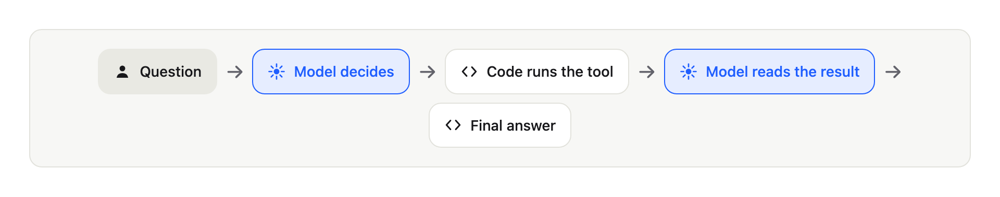
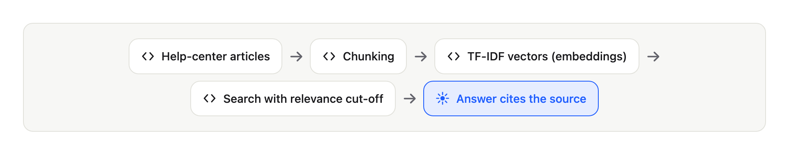
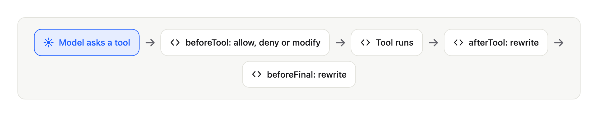

# Multi-agent systems in practice: RAG, MCP, guardrails and evals from scratch in Kotlin


> **Title options for Medium (pick one)**
> 1. *Career:* "I built a multi-agent AI assistant without a framework. Here is what it taught me."
> 2. *Tech stack:* "RAG, MCP and agents in Kotlin Multiplatform, step by step"
> 3. *Best practices:* "Guardrails, evals and clean architecture for AI agents: a practical guide"

## Introduction

Anyone can call a language model. Making it **safe, measurable and replaceable** is the hard part.

Most agent demos work once. Then a model invents a refund policy, reveals data it should not, or costs ten times more than planned. Clean code is how you avoid that: small pieces, clear boundaries, tests that run offline.

Kotlin is a good fit today. It is concise, typed, coroutine-friendly for parallel tool calls and, with Kotlin Multiplatform, the same core runs on the server, desktop and iOS. And there is an official MCP SDK for it.

This guide builds the whole thing in 12 small steps. Every step is a git tag. Beginners get the concept and an analogy. Seniors get the design decisions and the trade-offs.

## The project: DSupport

A customer support assistant. The customer writes:

> "My order 1042 has not arrived. My email is ana@example.com"

The assistant must:

- answer **only from sources** (help-center articles and order data);
- **hand the case to a human** when it cannot answer safely;
- **never invent** a ticket number or a policy;
- be **measured** by an evaluation, not by a good demo.

No agent framework. Every concept is visible in the code. Repository: github.com/diegoferreiracaetano/dsupport-kt

## Architecture and folder structure


Dependencies point **inward**. The core never imports a provider.

```text
dsupport-kt/
├── contract/      shared vocabulary (events, answer) - Kotlin Multiplatform
├── core/          ports, agent loop, guards, review, use case - Kotlin Multiplatform
├── adapters/      Anthropic client, RAG, JSON files, MCP client
├── cli/           terminal entry point
├── eval/          golden dataset, scoring, reports
├── mcp-orders/    MCP server (orders tools)
├── mcp-tickets/   MCP server (ticket tools)
├── server/        Ktor API (Server-Sent Events)
├── app/           Compose app (desktop and iOS)
├── config/        agents.json, mcp-servers.json
└── data/          orders, golden dataset, help-center articles
```

Rule of thumb: **ports in the core, adapters at the edge**.

## Step by step

### Setup

```bash
git clone https://github.com/diegoferreiracaetano/dsupport-kt
cd dsupport-kt
./gradlew test          # runs offline, no API key needed
```

Requirements: JDK 21. The Gradle JVM is pinned in `gradle/gradle-daemon-jvm.properties`.

### Step 1: Agent loop (the model decides, your code acts)



A model only produces text. The loop lets it ask for help, read the result and try again, until it answers or hits a limit.

```kotlin
// The port every tool implements. The agent cannot tell local from remote.
interface Tool {
    val spec: ToolSpec                      // name, description, JSON Schema
    suspend fun run(args: JsonObject): ToolResult
}
```

Always bound the loop (`maxTurns`). A confused model can call tools forever and burn money.

### Step 2: LLM client (one port, one adapter per provider)

The agent only knows a port. An adapter translates to the provider.

```kotlin
// Port, in the core. No provider import here.
interface LlmClient {
    suspend fun next(request: LlmRequest): LlmReply                 // text or tool calls
    suspend fun structured(request: LlmRequest, schema: OutputSchema): StructuredReply
}
```

`AnthropicLlmClient` is the adapter: it maps messages to JSON and retries on 429 and 5xx. A contract test suite proves any adapter behaves the same.

### Step 3: Tools (function calling)

```kotlin
class GetOrderStatusTool(private val orders: OrderGateway) : Tool {
    override val spec = ToolSpec(
        name = "get_order_status",
        description = "Looks up the status and delay of an order. Requires order_id and email.",
        inputSchema = stringSchema("order_id", "email"),
    )

    override suspend fun run(args: JsonObject): ToolResult {
        val orderId = args.stringArg("order_id") ?: return fail("missing_argument:order_id")
        val email = args.stringArg("email") ?: return fail("missing_argument:email")
        // A tool never throws: failures come back as a result the model can read.
        val order = orders.findOwned(orderId, email) ?: return fail("order_not_found_or_email_mismatch")
        return ok("status" to JsonPrimitive(order.status.wire), "eta" to JsonPrimitive(order.eta.toString()))
    }
}
```

The description is part of the prompt. A vague description makes the model pick the wrong tool.

### Step 4: RAG (Retrieval-Augmented Generation)



Models invent policies. RAG searches trusted articles first and answers from what it found.

1. `MarkdownChunker` splits articles into passages (chunking).
2. `TfIdfEmbedder` turns passages into vectors (embeddings).
3. `SearchKbTool` returns the closest passages **above a relevance cut-off (0.25)**.

Without the cut-off the search always returns something, and the model answers from an unrelated passage.

### Step 5: MCP (Model Context Protocol)

Orders and tickets belong to other systems. They run as separate **MCP servers**, using the official Kotlin SDK.

```json
{
  "servers": [
    { "name": "orders",  "command": ["mcp-orders/build/install/mcp-orders/bin/mcp-orders"],  "env": { "DATA_DIR": "data" } },
    { "name": "tickets", "command": ["mcp-tickets/build/install/mcp-tickets/bin/mcp-tickets"], "env": { "DATA_DIR": "data" } }
  ]
}
```

Adding a server is a line of configuration. The agent code does not change. A dead server becomes an error result, never a hang.

### Step 6: Multi-agent orchestration

One agent with every tool gets confused. An **orchestrator** delegates to specialists, each with a short prompt and only its own tools.

```json
{
  "agents": {
    "knowledge":  { "tools": ["search_kb"] },
    "orders":     { "tools": ["get_order_status", "track_shipment"] },
    "escalation": { "tools": ["create_ticket"] }
  }
}
```

Each specialist is exposed to the orchestrator **as a tool**. Calls in the same turn run in parallel (`async` + `awaitAll`) and keep their order.

### Step 7: Guardrails



A prompt is a suggestion. Guardrails are deterministic code around the model.

```kotlin
class IdentityGate : Hook {
    override val covers = setOf("get_order_status", "track_shipment")

    override suspend fun beforeTool(agent: String, tool: ToolSpec, args: JsonObject): Decision = when {
        // No valid order number: the model never reaches the tool.
        args.stringArg("order_id")?.let { digits.matches(it) } != true ->
            Decision.Deny("order_id is missing or invalid. Ask the customer for the order number.")
        args.stringArg("email")?.let { Patterns.email.matches(it) } != true ->
            Decision.Deny("email is missing or invalid. Ask the customer for the email used in the purchase.")
        else -> Decision.Allow
    }
}
```

The model cannot see or skip this. If a rule matters, enforce it in code.

### Step 8: Structured output and a reviewer

The final answer is a JSON form (`answer`, `intent`, `sources`, `confidence`, `escalated`, `ticket_id`) validated by code: an invented ticket id is rejected. A second model reviews the draft, **at most twice**. At the limit, code (not the model) opens a ticket for a human.

### Step 9: Observability and evals

Every step is an event with a `runId` and a `parentRunId`, so a trace tree and a cost per agent can be rebuilt:

```text
[orchestrator] r1
  model call: 900 in / 80 out tokens, 700 ms
  tool orders: 1300 ms
    [orders] r2
      model call: 400 in / 40 out tokens, 500 ms
```

Then **evals**: 15 golden cases, each run 3 times (models are not deterministic), scored by metrics.

| Metric | First run | After fixes |
|---|---|---|
| Expected facts present | 93% | 100% |
| Expected sources cited | 86% | 100% |
| Escalation precision | 80% | 100% |
| Review fallback | 9% | 0% |

The evals found problems I would never find by reading code: two rules that contradicted each other, a reviewer that invented objections and a deterministic routing error. Total cost: about 30 cents.

### Step 10: Server and app

```kotlin
// POST /chat streams one Server-Sent Events frame per AgentEvent.
post("/chat") {
    val question = receiveQuestion() ?: return@post call.respondText("bad request", status = BadRequest)
    call.respondTextWriter(ContentType.Text.EventStream) {
        answerCustomer(question).collect { event ->
            write(ServerSentEvents.frame(event))
            flush()                      // flush is what makes the live trace possible
        }
    }
}
```

The API key lives only on the server. The Compose app draws the conversation, the sources, an escalation badge and the live trace.

## Tests and containerization

One test class per production class, doubles at the ports, no API calls:

```kotlin
@Test
fun `given a malformed email when checking an order tool then should deny`() = runTest {
    val decision = gate.beforeTool("orders", spec("get_order_status"),
        argsOf("order_id" to "1042", "email" to "not-an-email"))

    assertIs<Decision.Deny>(decision)
}
```

A multi-stage `Dockerfile` for production (build with the JDK, run with the JRE):

```dockerfile
# Stage 1: build the distribution with the full JDK
FROM eclipse-temurin:21-jdk AS build
WORKDIR /src
COPY . .
RUN ./gradlew :server:installDist --no-daemon

# Stage 2: run it on a small JRE image
FROM eclipse-temurin:21-jre
WORKDIR /app
COPY --from=build /src/server/build/install/server/ ./
COPY config ./config
COPY data ./data
ENV DATA_DIR=data
EXPOSE 8080
CMD ["bin/server"]
```

```bash
docker build -t dsupport .
docker run -p 8080:8080 -e ANTHROPIC_API_KEY dsupport
```

## When not to use multiple agents

It is not free. One delayed-order question costs **12 model calls**. Use one agent with tools when the task is small. Split into specialists when prompts and toolsets grow and the roles are clearly different.

## Conclusion

The model decides, your code acts and checks. Rules live in code. Quality is measured. Providers are replaceable.

**Your turn:**

- Which of these concepts is new to you: RAG, MCP, guardrails or evals? Tell me in the comments.
- If you want a deep dive on any step, say which one.
- Share this with someone building agents. A star on the repository helps too: github.com/diegoferreiracaetano/dsupport-kt
