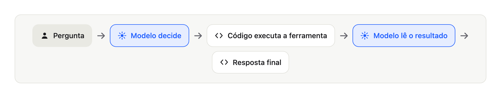
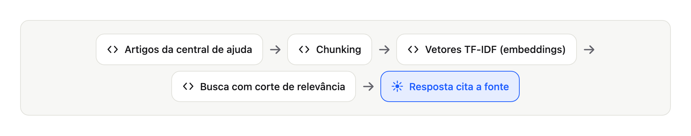
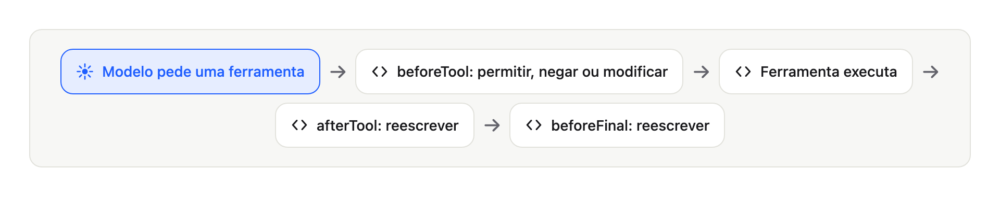

# Multiagentes na prática: RAG, MCP, guardrails e evals do zero em Kotlin


> **Opções de título para o Medium (escolha uma)**
> 1. *Carreira:* "Construí um assistente de IA multiagente sem framework. Eis o que aprendi."
> 2. *Stack:* "RAG, MCP e agentes em Kotlin Multiplatform, passo a passo"
> 3. *Boas práticas:* "Guardrails, evals e arquitetura limpa para agentes de IA: um guia prático"

## Introdução

Qualquer pessoa consegue chamar um modelo de linguagem. Torná-lo **seguro, mensurável e substituível** é a parte difícil.

A maioria das demos de agentes funciona uma vez. Depois o modelo inventa uma política de reembolso, revela dados que não devia ou custa dez vezes mais que o previsto. Código limpo é como você evita isso: peças pequenas, fronteiras claras, testes que rodam offline.

Kotlin é uma boa escolha hoje. É conciso, tipado, amigável a corrotinas (chamadas de ferramentas em paralelo) e, com Kotlin Multiplatform, o mesmo core roda no servidor, no desktop e no iOS. E existe um SDK oficial de MCP para ele.

Este guia constrói tudo em 12 passos pequenos. Cada passo é uma tag do git. Quem está começando recebe o conceito e uma analogia. Quem é sênior recebe as decisões de design e os trade-offs.

## O projeto: DSupport

Um assistente de suporte ao cliente. O cliente escreve:

> "My order 1042 has not arrived. My email is ana@example.com"

O assistente precisa:

- responder **só com fontes** (artigos da central de ajuda e dados de pedidos);
- **passar o caso a um humano** quando não consegue responder com segurança;
- **nunca inventar** um número de ticket ou uma política;
- ser **medido** por uma avaliação, não por uma boa demo.

Sem framework de agentes. Cada conceito aparece no código. Repositório: github.com/diegoferreiracaetano/dsupport-kt

## Arquitetura e estrutura de pastas


As dependências apontam **para dentro**. O core nunca importa um provedor.

```text
dsupport-kt/
├── contract/      vocabulário compartilhado (eventos, resposta) - Kotlin Multiplatform
├── core/          portas, laço do agente, guards, revisão, caso de uso - Kotlin Multiplatform
├── adapters/      cliente Anthropic, RAG, arquivos JSON, cliente MCP
├── cli/           entrada pelo terminal
├── eval/          golden dataset, pontuação, relatórios
├── mcp-orders/    servidor MCP (ferramentas de pedidos)
├── mcp-tickets/   servidor MCP (ferramentas de tickets)
├── server/        API Ktor (Server-Sent Events)
├── app/           app Compose (desktop e iOS)
├── config/        agents.json, mcp-servers.json
└── data/          pedidos, golden dataset, artigos da central de ajuda
```

Regra de bolso: **portas no core, adapters na borda**.

## Passo a passo

### Preparação

```bash
git clone https://github.com/diegoferreiracaetano/dsupport-kt
cd dsupport-kt
./gradlew test          # roda offline, sem chave de API
```

Requisito: JDK 21. A JVM do Gradle é fixada em `gradle/gradle-daemon-jvm.properties`.

### Passo 1: Agent loop (o modelo decide, o seu código age)



Um modelo só produz texto. O laço permite que ele peça ajuda, leia o resultado e tente de novo, até responder ou bater um limite.

```kotlin
// A porta que toda ferramenta implementa. O agente não distingue local de remota.
interface Tool {
    val spec: ToolSpec                      // nome, descrição, JSON Schema
    suspend fun run(args: JsonObject): ToolResult
}
```

Sempre limite o laço (`maxTurns`). Um modelo confuso pode chamar ferramentas para sempre e queimar dinheiro.

### Passo 2: Cliente de LLM (uma porta, um adapter por provedor)

O agente só conhece uma porta. Um adapter traduz para o provedor.

```kotlin
// Porta, no core. Nenhum import de provedor aqui.
interface LlmClient {
    suspend fun next(request: LlmRequest): LlmReply                 // texto ou chamadas de ferramenta
    suspend fun structured(request: LlmRequest, schema: OutputSchema): StructuredReply
}
```

O `AnthropicLlmClient` é o adapter: mapeia mensagens para JSON e repete em 429 e 5xx. Uma suíte de teste de contrato prova que qualquer adapter se comporta igual.

### Passo 3: Ferramentas (function calling)

```kotlin
class GetOrderStatusTool(private val orders: OrderGateway) : Tool {
    override val spec = ToolSpec(
        name = "get_order_status",
        description = "Consulta o status e o atraso de um pedido. Exige order_id e email.",
        inputSchema = stringSchema("order_id", "email"),
    )

    override suspend fun run(args: JsonObject): ToolResult {
        val orderId = args.stringArg("order_id") ?: return fail("missing_argument:order_id")
        val email = args.stringArg("email") ?: return fail("missing_argument:email")
        // Uma ferramenta nunca lança exceção: a falha volta como resultado que o modelo lê.
        val order = orders.findOwned(orderId, email) ?: return fail("order_not_found_or_email_mismatch")
        return ok("status" to JsonPrimitive(order.status.wire), "eta" to JsonPrimitive(order.eta.toString()))
    }
}
```

A descrição faz parte do prompt. Uma descrição vaga faz o modelo escolher a ferramenta errada.

### Passo 4: RAG (Retrieval-Augmented Generation)



Modelos inventam políticas. O RAG busca artigos confiáveis primeiro e responde a partir do que achou.

1. `MarkdownChunker` divide os artigos em trechos (chunking).
2. `TfIdfEmbedder` transforma os trechos em vetores (embeddings).
3. `SearchKbTool` devolve os trechos mais próximos **acima de um corte de relevância (0,25)**.

Sem o corte, a busca sempre devolve algo, e o modelo responde com base em um trecho sem relação.

### Passo 5: MCP (Model Context Protocol)

Pedidos e tickets pertencem a outros sistemas. Eles rodam como **servidores MCP** separados, com o SDK oficial do Kotlin.

```json
{
  "servers": [
    { "name": "orders",  "command": ["mcp-orders/build/install/mcp-orders/bin/mcp-orders"],  "env": { "DATA_DIR": "data" } },
    { "name": "tickets", "command": ["mcp-tickets/build/install/mcp-tickets/bin/mcp-tickets"], "env": { "DATA_DIR": "data" } }
  ]
}
```

Adicionar um servidor é uma linha de configuração. O código do agente não muda. Um servidor morto vira resultado de erro, nunca trava.

### Passo 6: Orquestração multiagente

Um agente com todas as ferramentas se confunde. Um **orquestrador** delega a especialistas, cada um com um prompt curto e só as suas ferramentas.

```json
{
  "agents": {
    "knowledge":  { "tools": ["search_kb"] },
    "orders":     { "tools": ["get_order_status", "track_shipment"] },
    "escalation": { "tools": ["create_ticket"] }
  }
}
```

Cada especialista é exposto ao orquestrador **como uma ferramenta**. Chamadas no mesmo turno rodam em paralelo (`async` + `awaitAll`) e mantêm a ordem.

### Passo 7: Guardrails



Um prompt é uma sugestão. Guardrails são código determinístico em volta do modelo.

```kotlin
class IdentityGate : Hook {
    override val covers = setOf("get_order_status", "track_shipment")

    override suspend fun beforeTool(agent: String, tool: ToolSpec, args: JsonObject): Decision = when {
        // Sem número de pedido válido: o modelo nunca chega à ferramenta.
        args.stringArg("order_id")?.let { digits.matches(it) } != true ->
            Decision.Deny("order_id is missing or invalid. Ask the customer for the order number.")
        args.stringArg("email")?.let { Patterns.email.matches(it) } != true ->
            Decision.Deny("email is missing or invalid. Ask the customer for the email used in the purchase.")
        else -> Decision.Allow
    }
}
```

O modelo não vê nem pula isso. Se uma regra importa, imponha no código.

### Passo 8: Saída estruturada e um revisor

A resposta final é um formulário JSON (`answer`, `intent`, `sources`, `confidence`, `escalated`, `ticket_id`) validado por código: um id de ticket inventado é rejeitado. Um segundo modelo revisa o rascunho, **no máximo duas vezes**. No limite, o código (não o modelo) abre um ticket para um humano.

### Passo 9: Observabilidade e evals

Cada passo é um evento com `runId` e `parentRunId`, então dá para reconstruir uma árvore de rastro e o custo por agente:

```text
[orchestrator] r1
  model call: 900 in / 80 out tokens, 700 ms
  tool orders: 1300 ms
    [orders] r2
      model call: 400 in / 40 out tokens, 500 ms
```

Depois, os **evals**: 15 casos dourados, cada um rodado 3 vezes (modelos não são determinísticos), pontuados por métricas.

| Métrica | Primeira rodada | Depois das correções |
|---|---|---|
| Fatos esperados presentes | 93% | 100% |
| Fontes esperadas citadas | 86% | 100% |
| Precisão de escalonamento | 80% | 100% |
| Fallback da revisão | 9% | 0% |

Os evals acharam problemas que eu nunca acharia lendo o código: duas regras que se contradiziam, um revisor que inventava objeções e um erro de roteamento determinístico. Custo total: cerca de 30 centavos.

### Passo 10: Servidor e app

```kotlin
// POST /chat transmite um quadro Server-Sent Events por AgentEvent.
post("/chat") {
    val question = receiveQuestion() ?: return@post call.respondText("bad request", status = BadRequest)
    call.respondTextWriter(ContentType.Text.EventStream) {
        answerCustomer(question).collect { event ->
            write(ServerSentEvents.frame(event))
            flush()                      // o flush é o que torna o rastro ao vivo possível
        }
    }
}
```

A chave da API vive só no servidor. O app Compose desenha a conversa, as fontes, um selo de escalonamento e o rastro ao vivo.

## Testes e containerização

Uma classe de teste por classe de produção, dublês nas portas, nenhuma chamada de API:

```kotlin
@Test
fun `given a malformed email when checking an order tool then should deny`() = runTest {
    val decision = gate.beforeTool("orders", spec("get_order_status"),
        argsOf("order_id" to "1042", "email" to "not-an-email"))

    assertIs<Decision.Deny>(decision)
}
```

Um `Dockerfile` multi-stage para produção (compila com o JDK, roda com o JRE):

```dockerfile
# Estágio 1: gera a distribuição com o JDK completo
FROM eclipse-temurin:21-jdk AS build
WORKDIR /src
COPY . .
RUN ./gradlew :server:installDist --no-daemon

# Estágio 2: roda numa imagem JRE pequena
FROM eclipse-temurin:21-jre
WORKDIR /app
COPY --from=build /src/server/build/install/server/ ./
COPY config ./config
COPY data ./data
ENV DATA_DIR=data
EXPOSE 8080
CMD ["bin/server"]
```

```bash
docker build -t dsupport .
docker run -p 8080:8080 -e ANTHROPIC_API_KEY dsupport
```

## Quando não usar vários agentes

Não é de graça. Uma pergunta de pedido atrasado custa **12 chamadas ao modelo**. Use um agente com ferramentas quando a tarefa é pequena. Divida em especialistas quando prompts e ferramentas crescem e os papéis são claramente diferentes.

## Conclusão

O modelo decide, o seu código age e confere. As regras vivem no código. A qualidade é medida. Os provedores são substituíveis.

**Sua vez:**

- Qual destes conceitos é novo para você: RAG, MCP, guardrails ou evals? Conte nos comentários.
- Se quiser um mergulho em algum passo, diga qual.
- Compartilhe com quem está construindo agentes. Uma estrela no repositório também ajuda: github.com/diegoferreiracaetano/dsupport-kt
